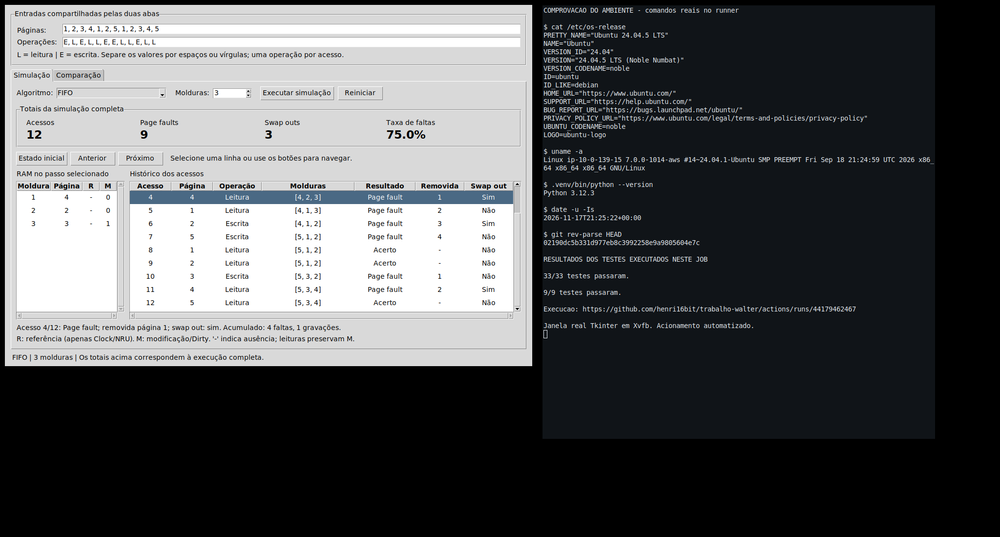

# Gerência de memória virtual — UNIRP

Trabalho de Sistemas Operacionais do curso de Análise e Desenvolvimento de Sistemas, professor Walter Gomes Pedroso Junior. Simulador em Python para **Linux**, com interface gráfica Tkinter/ttk e execução pelo terminal. Implementa FIFO, LRU, Segunda Chance (Clock) e NRU.

Repositório público: [henri16bit/trabalho-walter](https://github.com/henri16bit/trabalho-walter).

**Integrantes:** Henrique Caliari Fuzeto — RA **20252889**; Murillo Alves Augusto — RA **20251873**.

## Comprovação de execução em GNU/Linux

O simulador foi executado novamente no **Ubuntu 24.04.5 LTS em 17/11/2026**: **33/33 testes sem janela e 9/9 testes gráficos aprovados**. A imagem abaixo mostra a janela real com uma simulação, ao lado de um terminal que identifica Ubuntu, kernel, Python, data, commit e execução. A compatibilidade adicional com Windows não muda o ambiente das evidências apresentadas.



Captura real por `scrot` no display virtual Xvfb do Ubuntu remoto. A simulação foi acionada por código; os totais dos testes foram lidos dos logs do mesmo job. Isso comprova a execução e a renderização no Linux, mas não uma sessão humana de cliques. O teste da interface não substitui o laboratório.

| O que conferir | Evidências |
|---|---|
| Simulador no Ubuntu, 17/11/2026 | [Execução e logs do Actions](https://github.com/henri16bit/trabalho-walter/actions/runs/44179462467), [ambiente](evidencias/simulador_linux_20261117_44179462467/ambiente.txt), [33 testes](evidencias/simulador_linux_20261117_44179462467/testes_logica.txt), [9 testes gráficos](evidencias/simulador_linux_20261117_44179462467/testes_interface.txt), [comparação na GUI](evidencias/simulador_linux_20261117_44179462467/interface_comparacao.png) |
| Resultados gerados nessa execução | [Terminal](evidencias/simulador_linux_20261117_44179462467/terminal.txt), [CSV](evidencias/simulador_linux_20261117_44179462467/comparacao.csv), [page faults](evidencias/simulador_linux_20261117_44179462467/page_faults.png), [swap outs simulados](evidencias/simulador_linux_20261117_44179462467/swap_outs.png), [hashes](evidencias/simulador_linux_20261117_44179462467/SHA256SUMS) e [proveniência](evidencias/simulador_linux_20261117_44179462467/proveniencia.json) |
| Laboratório no Ubuntu, 13/11/2026 | [Execução separada do laboratório](https://github.com/henri16bit/trabalho-walter/actions/runs/43505223640), [oito capturas](evidencias/linux_20261113T205043Z_3277/capturas/), [comandos e saídas](evidencias/linux_20261113T205043Z_3277/), [interpretações](evidencias/observacoes.md) |
| Swap sob pressão isolada, 17/11/2026 | [Execução real](https://github.com/henri16bit/trabalho-walter/actions/runs/44182556307), [três capturas](evidencias/swap_linux_20261117T214237Z_3360/capturas/), [comparação medida](evidencias/swap_linux_20261117T214237Z_3360/comparacao.csv), [análise e limites](evidencias/swap_observacoes.md) |

O [relatório revisado](relatorio.md) contém as sete seções, os nomes/RAs, resultados e capturas com legendas. A [matriz de requisitos](evidencias/REQUISITOS.md) registra o atendimento e os limites. **Swap sob pressão e impacto de E/S foram demonstrados em 17/11:** a mesma carga de 128 MiB foi executada com limites de RAM de 256 e 64 MiB, em grupos isolados. A coleta inicial de 32 MiB sem swap continua preservada. Faltam a revisão da dupla, a data efetiva de entrega e a exportação final.

Para conferir a origem, abra a execução do simulador, selecione o job **validar** e consulte as etapas de testes e captura; o commit deve corresponder ao de `ambiente.txt`. O GitHub pode exigir login para consultar os logs, conforme sua [documentação](https://docs.github.com/en/actions/how-tos/monitor-workflows/use-workflow-run-logs). Os TXT e PNG já estão publicados nesta pasta pública e podem ser acessados diretamente. O registro `resultados/validacao_windows.txt`, com 25 testes, é histórico e não é a comprovação Linux.

## Comece por aqui — passo a passo para a dupla no Linux

O roteiro abaixo usa **Ubuntu 24.04**, ambiente em que o código foi validado com Python **3.12.3** e matplotlib **3.11.2**. O projeto exige Python **3.11 ou superior**. Os comandos devem ser executados no terminal do Linux. Para ver e usar a janela, abra o terminal em uma sessão Linux com ambiente gráfico.

Se estiver em um servidor Linux sem tela, use a versão de terminal descrita abaixo. A janela não aparece em um terminal remoto comum nem em uma página do navegador.

### 1. Instalar os programas necessários

No terminal do Ubuntu 24.04:

```bash
sudo apt-get update
sudo apt-get install -y git python3 python3-venv python3-tk
python3 --version
```

Confira se a versão exibida é pelo menos 3.11. O `sudo` pode pedir a senha do usuário; o terminal não mostra os caracteres enquanto você digita.

O pacote [python3-venv](https://packages.ubuntu.com/noble/python3-venv) permite criar o ambiente Python do projeto; [python3-tk](https://packages.ubuntu.com/noble/python3-tk) fornece o Tkinter. Em outras distribuições Linux, os comandos de instalação dos pacotes podem mudar; os passos seguintes usam o mesmo Python do ambiente virtual.

### 2. Baixar o projeto

Estes comandos criam a pasta `Projetos` dentro da sua pasta pessoal e baixam o código:

```bash
mkdir -p ~/Projetos
cd ~/Projetos
git clone https://github.com/henri16bit/trabalho-walter.git
cd trabalho-walter
ls
```

Na listagem devem aparecer `interface.py`, `main.py`, `requirements.txt` e `testes.py`. Por ser um repositório público, não é preciso entrar na conta do GitHub para cloná-lo. Se essa pasta já existir por uma instalação anterior, siga a seção de atualização abaixo.

Também é possível usar **Code → Download ZIP** no GitHub. Extraia o ZIP e abra o terminal na pasta que contém esses arquivos. Nesse caso, adapte o caminho nos comandos `cd` deste guia e baixe um novo ZIP quando quiser atualizar.

### 3. Criar o ambiente e instalar as dependências

Com o terminal dentro da pasta do projeto:

```bash
python3 -m venv .venv
.venv/bin/python -m pip install -r requirements.txt
```

A instalação precisa de internet. A pasta `.venv` deve ser criada no próprio Linux; ela não acompanha o repositório e não deve ser copiada de outro computador. Não é necessário ativar o ambiente, pois os comandos deste guia usam diretamente `.venv/bin/python`, conforme a [documentação do venv](https://docs.python.org/3/library/venv.html).

### 4. Abrir a interface gráfica

```bash
.venv/bin/python interface.py
```

A janela do simulador será aberta. Para uma primeira execução:

1. Mantenha a sequência que já aparece nos campos **Páginas** e **Operações**.
2. Na aba **Simulação**, selecione um algoritmo e a quantidade de **Molduras**, por exemplo FIFO e 3.
3. Clique em **Executar simulação**.
4. Use **Estado inicial**, **Anterior** e **Próximo**, ou clique nas linhas do histórico, para acompanhar cada acesso e o estado da RAM.
5. Confira os totais de acessos, page faults, swap outs e a taxa de faltas. Os totais no topo são da simulação completa; a linha abaixo das tabelas mostra os valores acumulados até o passo selecionado.

Para informar outra sequência, preencha os dois campos com valores separados por espaços ou vírgulas. As páginas são inteiros não negativos. Use **L para leitura** e **E para escrita**, com exatamente uma operação para cada página. Exemplo:

```text
Páginas:   1, 2, 1, 3, 1, 2
Operações: E, L, L, E, L, L
```

Digite apenas os valores, sem os rótulos `Páginas:` e `Operações:`. Depois de editar, execute a simulação novamente.

### 5. Comparar os algoritmos e salvar os resultados

1. Abra a aba **Comparação**. Ela usa as mesmas páginas e operações dos campos no topo.
2. Clique em **Comparar algoritmos**. Serão calculados 16 resultados: quatro algoritmos com **3, 4, 8 e 16 molduras**. O campo Molduras da aba Simulação não altera essas quantidades.
3. Clique em **Visualizar gráficos** para abrir os gráficos de page faults e swap outs.
4. Clique em **Salvar CSV e PNG** e escolha uma pasta. Serão gravados `comparacao.csv`, `page_faults.png` e `swap_outs.png`.

Para experiências próprias, escolha uma pasta como `resultados/manual`. Se os arquivos já existirem, a interface pede confirmação antes de substituí-los. Visualizar os gráficos, por si só, não salva uma cópia permanente.

### 6. Conferir a instalação com os testes

Na pasta do projeto, execute os dois comandos separadamente:

```bash
.venv/bin/python testes.py
.venv/bin/python testes.py --interface
```

O primeiro executa **33 testes sem abrir janelas**; o segundo executa **9 testes gráficos**, que abrem e fecham janelas automaticamente e precisam de uma sessão gráfica. O primeiro conjunto também importa o Tkinter, por isso o pacote `python3-tk` é necessário mesmo sem abrir uma janela.

Na [validação de 17/11/2026 no Ubuntu 24.04.5](https://github.com/henri16bit/trabalho-walter/actions/runs/44179462467), os resultados foram **33/33** e **9/9**, totalizando **42 testes aprovados** no commit `02190dc`. Os testes gráficos usaram widgets reais em Xvfb, acionados automaticamente, com respostas programadas aos diálogos. Confira a saída real na sua máquina para confirmar a instalação.

### 7. Abrir novamente e atualizar

Depois da instalação, para abrir o programa em outro dia:

```bash
cd ~/Projetos/trabalho-walter
.venv/bin/python interface.py
```

Não é necessário recriar o ambiente nem reinstalar os pacotes a cada execução. Se baixou o ZIP ou escolheu outra pasta, use o caminho correspondente.

Para receber novas alterações em uma cópia baixada com `git clone`, feche o programa e execute:

```bash
cd ~/Projetos/trabalho-walter
git pull --ff-only
.venv/bin/python -m pip install -r requirements.txt
```

Se o Git informar que suas alterações locais impedem a atualização, preserve esses arquivos e resolva a mensagem antes de continuar. Não é preciso apagar a pasta do projeto.

## Executar pelo terminal

A versão de terminal funciona sem abrir janelas. Na pasta do projeto:

```bash
.venv/bin/python main.py
```

O comando usa a sequência pronta, compara os quatro algoritmos com 3, 4, 8 e 16 molduras e mostra a tabela no terminal. Também grava `resultados/comparacao.csv`, `resultados/page_faults.png` e `resultados/swap_outs.png`.

Para escolher as molduras ou digitar páginas e operações:

```bash
.venv/bin/python main.py --molduras 3 4 --saida resultados/comparacao_3_4
.venv/bin/python main.py --manual --molduras 3 4 8 16 --saida resultados/manual
```

No modo `--manual`, digite os valores quando cada pergunta aparecer, usando o mesmo formato explicado para a interface. Cada execução do terminal substitui os três arquivos na pasta de saída escolhida, sem pedir confirmação. Use uma pasta diferente em `--saida` para guardar comparações distintas.

## Testes gráficos em Linux sem tela

Em um Ubuntu sem ambiente gráfico, é possível testar a interface com Xvfb:

```bash
sudo apt-get install -y xvfb xauth
xvfb-run -a -s '-screen 0 1280x900x24' .venv/bin/python testes.py --interface
```

Esse comando executa os testes em uma tela virtual; ele não mostra uma janela interativa para você usar. Para trabalhar normalmente sem tela, execute `main.py`. A automação completa está em [.github/workflows/validar-linux.yml](.github/workflows/validar-linux.yml).

## Se aparecer um erro

| Situação | O que conferir ou executar |
|---|---|
| `python3` ou `git` não foi encontrado | Execute a instalação da etapa 1 no terminal do Ubuntu. |
| A versão do Python é menor que 3.11 | Use um ambiente Linux com Python 3.11 ou superior; o ambiente validado foi Ubuntu 24.04 com Python 3.12.3. |
| Erro de `ensurepip` ou falha ao criar `.venv` | Instale `python3-venv` e repita `python3 -m venv .venv`. |
| `.venv/bin/python` não existe | Confira a pasta com `pwd` e `ls -a`; execute a etapa 3 dentro da pasta do projeto. Uma `.venv` criada no Windows não serve para o Linux. |
| `interface.py`, `main.py` ou `requirements.txt` não foi encontrado | Entre na pasta que contém esses arquivos antes de executar os comandos. Se baixou ZIP, extraia-o primeiro. |
| `No module named tkinter` ou `_tkinter` | No Ubuntu, instale `python3-tk` para o Python usado na criação da `.venv`. Tkinter é um pacote do sistema, não uma dependência a instalar com pip. |
| `No module named matplotlib` ou `PIL` | Execute `.venv/bin/python -m pip install -r requirements.txt` e use esse mesmo Python para abrir o programa. |
| `externally-managed-environment` ao instalar dependências | Use `.venv/bin/python -m pip install -r requirements.txt`, depois de criar o ambiente da etapa 3. |
| `no display name`, erro de `$DISPLAY` ou falha ao abrir a janela | Abra o terminal em uma sessão gráfica Linux. Em um servidor sem tela, use `main.py`; para testes gráficos, use Xvfb conforme a seção anterior. |
| Entrada inválida | Informe molduras maiores que zero, páginas inteiras não negativas e uma operação L/E por página. |

Para verificar somente o Tkinter em uma sessão gráfica, execute `.venv/bin/python -m tkinter`; uma pequena janela de demonstração deve abrir. Esse diagnóstico está descrito na [documentação oficial do Tkinter](https://docs.python.org/3/library/tkinter.html).

Se precisar de ajuda, copie o comando executado e a mensagem completa do erro, junto da distribuição Linux e da saída de `python3 --version`. Isso ajuda a identificar a causa antes de alterar dependências ou algoritmos.

## Texto pronto para pedir ajuda a uma IA

Abra a pasta do projeto na ferramenta de IA ou forneça os arquivos necessários. Se ela não puder acessar o repositório, envie `README.md`, `requirements.txt`, `interface.py`, `main.py`, `algoritmos.py`, `graficos.py` e `testes.py`. Copie e preencha:

```text
Estou trabalhando em dupla no simulador de memória virtual da UNIRP.
Repositório público: https://github.com/henri16bit/trabalho-walter

Minha distribuição Linux e versão: [preencher]
Versão do Python (python3 --version): [preencher]
Ambiente: [Linux com interface gráfica / servidor Linux sem tela]
Meu objetivo: [instalar / executar / entender o código / resolver um erro]
Comando executado e mensagem completa de erro: [preencher, se houver]

Leia o README e o código atual antes de orientar mudanças. Ajude com passos
curtos e comandos de terminal Linux. O ambiente validado é Ubuntu 24.04,
Python 3.12.3, com python3-venv, python3-tk e requirements.txt instalado
em uma .venv criada no próprio Linux.

Use .venv/bin/python interface.py para a interface Tkinter/ttk existente
e .venv/bin/python main.py para a versão de terminal. Sem ambiente gráfico,
use main.py; Xvfb serve para testar a interface sem exibir uma janela ao usuário.
Rode .venv/bin/python testes.py (33 testes) e, com display disponível,
.venv/bin/python testes.py --interface (9 testes). Os 25 testes originais
estão preservados dentro do primeiro conjunto. Não invente testes executados
ou resultados: informe os comandos que realmente rodou e suas saídas.

Ajude com instalação, execução e código. Para revisar o relatório, use apenas
evidências verificáveis e mantenha explícitas as limitações do laboratório.
Para o laboratório, leia evidencias/observacoes.md e use o workflow
laboratorio-linux.yml em um Ubuntu remoto. As evidências existentes são reais;
se repetir, preserve a nova coleta separadamente e registre suas limitações.
Para o complemento de swap, leia evidencias/swap_observacoes.md e use
swap-linux.yml: carga fixa de 128 MiB em cgroup limitado, sem esgotar RAM global.
Não instale WSL, Docker ou máquinas virtuais no computador Windows.

Preserve os quatro algoritmos: FIFO, LRU, Segunda Chance/Clock e NRU.
No NRU, limpe R antes dos acessos 5, 9, 13... e desempate pelo menor índice
de moldura. Leitura preserva Dirty; somente remover uma página modificada
conta como swap out. Cada execução começa com estado independente.

A interface já existe: preserve a navegação do histórico, a exibição da RAM
e a comparação dos quatro algoritmos com 3, 4, 8 e 16 molduras. Os cálculos
ficam em algoritmos.py, compartilhados pela interface e pelo terminal.
Não recrie o programa nem troque a interface por web ou outro framework.

Para experiências pelo terminal, use --saida resultados/manual ou outra
pasta própria. Explique qualquer alteração no código e valide o comportamento.
Ao concluir, diga o que funcionou e o que ainda precisa ser resolvido.
```

## Regras do simulador

A sequência pronta possui 12 acessos:

```text
Páginas:   1 2 3 4 1 2 5 1 2 3 4 5
Operações: E L E L L E E L L E L L
```

Cada algoritmo começa com memória vazia e estado próprio. Uma página ausente gera um page fault; escrita marca M/Dirty e leitura preserva esse bit. Somente a retirada de uma página modificada conta como swap out. Não há gravação extra ao terminar a simulação.

No NRU, a classe é `2*R + M`. Os bits R são zerados antes dos acessos **5, 9, 13...**, incluindo acertos na contagem do intervalo. O acesso atual marca R novamente. M nunca é apagado pela limpeza. Empates são resolvidos pelo **menor índice de moldura**, começando em zero. A Segunda Chance usa seu próprio ponteiro circular e limpa R durante a busca por uma vítima.

Esses contadores representam um modelo didático. O programa não modifica a memória virtual nem o swap do sistema operacional.

## Arquivos

| Arquivo/pasta | Finalidade |
|---|---|
| `interface.py` | Janela Tkinter/ttk, histórico, RAM e comparação |
| `main.py` | Entrada, execução dos algoritmos e tabela no terminal |
| `algoritmos.py` | Quatro algoritmos, validação das entradas e histórico opcional |
| `graficos.py` | CSV e dois gráficos PNG |
| `testes.py` | 33 testes sem janela e 9 testes gráficos |
| `requirements.txt` | Dependência matplotlib |
| `laboratorio_linux.sh` | Coleta dos três exercícios em GNU/Linux |
| `relatorio.md` | Sete seções, identificação da dupla, resultados Ubuntu, capturas e limites; revisão acadêmica final pendente |
| `resultados/` | CSV e gráficos; também conserva o registro histórico da validação no Windows |
| `evidencias/observacoes.md` | Saídas reais, interpretação técnica e limitações do laboratório |
| `evidencias/swap_observacoes.md` | Complemento com uso real de swap e comparação de tempo/E/S sob pressão isolada |
| `evidencias/REQUISITOS.md` | Relação entre requisitos, evidências e pendências |
| `evidencias/simulador_linux_20261117_44179462467/` | Capturas reais, 33+9 testes, CLI, CSV/PNG, ambiente e hashes da validação Ubuntu |
| `.github/workflows/laboratorio-linux.yml` | Executa a Parte II em um Ubuntu remoto |
| `.github/workflows/swap-linux.yml` | Executa o complemento de swap em dois cgroups limitados no Ubuntu remoto |
| `scripts/laboratorio_swap.py` | Carga fixa, limites, medição, comparação e limpeza das unidades criadas |
| `scripts/capturar_swap.sh` | Capturas reais de terminal reexibindo a coleta de swap |
| `scripts/capturar_laboratorio.sh` | Captura um terminal real reexibindo as saídas coletadas |
| `.github/workflows/validar-linux.yml` | Validação no Ubuntu com testes, CLI e capturas reais da interface |
| `.gitignore` | Exclui ambiente Python e caches do controle de versão |
| `.gitattributes` | Mantém fontes com LF e preserva os bytes das evidências brutas |

Para entregar o projeto, inclua os fontes, documentos, resultados e evidências; exclua `.venv` e `__pycache__`.

## Laboratório GNU/Linux remoto — Parte II

**Execução real realizada em 13/11/2026**, em Ubuntu 24.04.5 no GitHub Actions: [ver execução e logs](https://github.com/henri16bit/trabalho-walter/actions/runs/43505223640). Isso é uma coleta dos comandos do sistema operacional, separada dos 33+9 testes do simulador.

| Atividade | Resultado observado |
|---|---|
| `pmap -x` e `/proc/PID/maps` | Mapeamentos reais do PID 3311, com código, dados, heap, stack, bibliotecas e permissões |
| `ps`, `top`, `strace -c` | Transições `R`/`S` e 769 chamadas de sistema; nenhuma ferramenta bloqueada |
| `free -h`, `memstat`, `/proc/swaps` e carga | Alocação real de 32 MiB por 20 segundos; RSS antes/durante/depois registrado |
| Uso de swap sob pressão elevada | A carga inicial de 13/11 não usou swap. O complemento de 17/11 demonstrou swap e E/S sob limite de RAM por cgroup; veja abaixo |

Consulte as [explicações da coleta inicial](evidencias/observacoes.md), a [análise do swap](evidencias/swap_observacoes.md), a [matriz de requisitos](evidencias/REQUISITOS.md) e os [arquivos brutos de 13/11](evidencias/linux_20261113T205043Z_3277/). As coletas são separadas: os registros antigos continuam mostrando ausência de swap naquela execução.

### Complemento: swap observado em 17/11/2026

Na [execução 44182556307](https://github.com/henri16bit/trabalho-walter/actions/runs/44182556307), uma carga fixa de **128 MiB** foi executada primeiro com limite de RAM de **256 MiB**, depois de **64 MiB**. O limite se aplica ao grupo do processo, enquanto o servidor manteve aproximadamente 14 GiB disponíveis. Os dois processos terminaram com sucesso, sem OOM.

| Medida real | Controle | Pressão no cgroup |
|---|---:|---:|
| Maior swap do grupo amostrado | 0 | 127,996 MiB |
| Tempo das três passagens pela memória | 0,008239 s | 3,292881 s |
| Major faults nas passagens | 0 | 12.832 |
| E/S de leitura do grupo, Δ antes → após releituras | 0 B | 413.949.952 B |
| E/S de escrita do grupo, mesmo intervalo | 16.384 B | 484.184.064 B |

`/proc/swaps` registrou **0 → 75.032 → 131.068 → 0 KiB** antes, após alocar, após reler e depois do encerramento. Os [dados completos](evidencias/swap_linux_20261117T214237Z_3360/), [print do resumo](evidencias/swap_linux_20261117T214237Z_3360/capturas/swap_resumo.png) e [print de RAM/swap](evidencias/swap_linux_20261117T214237Z_3360/capturas/swap_ram.png) permitem conferir esses resultados.

É uma demonstração de pressão limitada ao processo. Os tempos pertencem a esta execução; não representam custo universal de swap. A E/S do cgroup inclui logs/metadados, e os contadores `pswpin/out` são globais. A [análise técnica](evidencias/swap_observacoes.md) explica essas diferenças.

Para repetir no GitHub, abra **Actions → Laboratorio GNU-Linux - Swap isolado → Run workflow → main**. É necessária permissão de escrita para iniciar a execução. Baixe o artefato **laboratorio-swap-isolado**, preserve a pasta datada em `evidencias/` e confira `resumo.txt`, `comandos.tsv`, os dois arquivos `*_resultado_unidade.txt` e `SHA256SUMS`.

O roteiro só inicia no runner GNU/Linux remoto, verifica margens de memória e swap, usa serviços transitórios e limita cada um a **256 MiB de swap e 60 segundos**, além de CPU, espaço virtual e tarefas. A carga é sempre de 128 MiB; nenhum parâmetro permite ampliá-la pelo workflow. Ele usa o swap existente e não muda configurações globais. Se houver limitação, ela aparece em `limitacao.txt`; um job verde deve ser conferido junto aos valores medidos.

### Repetir no GitHub Actions

1. Abra a aba **Actions** deste repositório.
2. Selecione **Laboratorio GNU-Linux - Parte II**.
3. Com permissão de escrita no repositório, clique em **Run workflow**, escolha `main` e confirme a execução. O parceiro pode consultar as evidências públicas sem iniciar uma nova coleta.
4. Aguarde as etapas de preparação, execução, capturas e upload. O runner é Ubuntu; nenhum Linux é instalado no computador de quem inicia a execução.
5. Abra a execução e baixe o artefato **laboratorio-gnu-linux**. Cada coleta tem uma pasta `linux_DATA_PID`, com data UTC. Guarde-a dentro de `evidencias/`, preservando as anteriores.
6. Confira `comandos.tsv`, `execucao.txt`, `carga.txt` e `carga_exit_code.txt`. Um workflow concluído não elimina limitações registradas nos arquivos, como carga dispensada ou ferramenta indisponível.

Para conferir os arquivos baixados, entre na pasta da coleta no terminal Linux e execute:

```bash
sha256sum -c SHA256SUMS
```

Os artefatos do Actions ficam disponíveis por 30 dias nesta configuração; as coletas do laboratório e a validação do simulador publicadas em `evidencias/` permanecem no repositório. Não use a expiração de um artefato como motivo para perder os arquivos.

### Repetir em outro Ubuntu remoto

No terminal do Ubuntu remoto, dentro da pasta do projeto:

```bash
sudo apt-get update
sudo apt-get install -y python3 procps strace memstat
bash -n laboratorio_linux.sh
bash laboratorio_linux.sh
```

`procps` fornece `pmap`, `ps`, `top` e `free`. O roteiro não instala pacotes; o comando `apt-get` acima prepara o ambiente. Sem permissão administrativa ou com alguma ferramenta bloqueada, preserve a mensagem real e registre a limitação.

O script cria um processo Python pequeno para mapear memória e alterna computação/espera para amostrar estados. Depois rastreia outro Python com `strace -c`. A carga de memória é independente: **no máximo 32 MiB, durante 20 segundos**, limitada também a 10% da margem observada. Exige pelo menos 256 MiB de margem, consulta `MemAvailable` e cgroup v2, aplica `RLIMIT_AS=256 MiB` e toca as páginas alocadas.

Se não puder verificar os limites ou faltar margem, a carga é dispensada. O script não cria swap nem aumenta a carga para provocar paginação. Memória virtual relatada por `memstat`, RSS e RAM global do `free` são medidas diferentes; veja a interpretação dos valores realmente obtidos em `evidencias/observacoes.md`.

### Capturas e limites da evidência

Nas coletas publicadas, `scrot` capturou um **xterm real em Xvfb**, reexibindo as saídas já coletadas. Os cabeçalhos dizem isso explicitamente. Não são imagens geradas por IA, capturas de uma nova medição ao vivo ou testes de interação humana.

Para reproduzir as capturas de uma coleta, instale as ferramentas **no Ubuntu remoto**:

```bash
sudo apt-get install -y xvfb xauth xterm scrot fonts-dejavu-core
```

Use o caminho da sua coleta como argumento. Exemplo com a coleta principal deste repositório:

```bash
xvfb-run -a -s '-screen 0 1600x1450x24' bash scripts/capturar_laboratorio.sh evidencias/linux_20261113T205043Z_3277
```

Esse comando salva PNGs na subpasta `capturas/`. Para preservar o manifesto de integridade de uma coleta publicada, faça essa reprodução em uma cópia da pasta; PNGs recapturados podem diferir dos originais.

### Pendências

- Swap e impacto de E/S foram observados sob **limite de RAM no cgroup**. Os tempos são demonstrativos; não houve esgotamento da RAM global e não se deve ampliar a carga para tentar reproduzir um travamento.
- `R` agrupa execução e prontidão no Linux; as amostras não distinguem individualmente Running/Ready. O estado de espera observado foi `S`, com temporizador, não `D` por disco.
- O `memstat` foi executado como `runner`, com visibilidade dos processos permitidos a esse usuário.
- O [relatório](relatorio.md) tem os nomes/RAs e as evidências reais. Faltam data efetiva de entrega, revisão e lições da dupla, além da exportação para PDF ou Google Docs exigida pelo enunciado.
