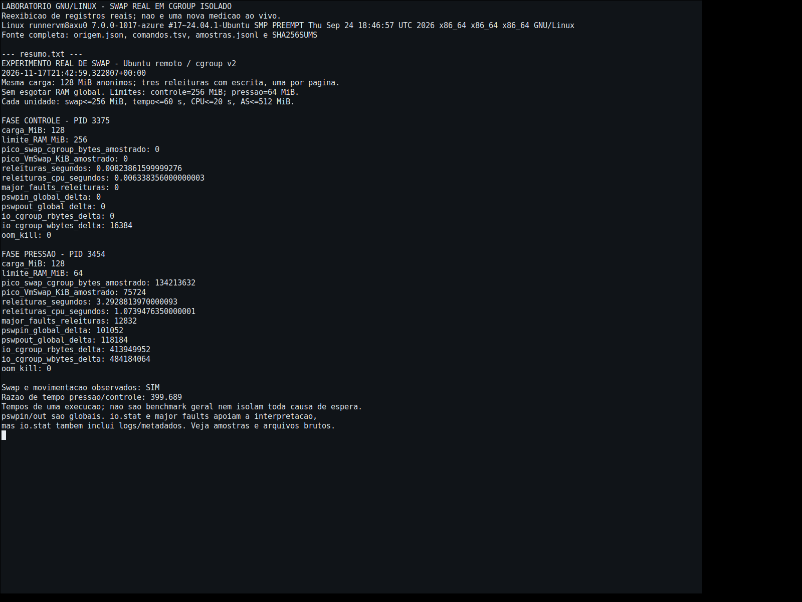
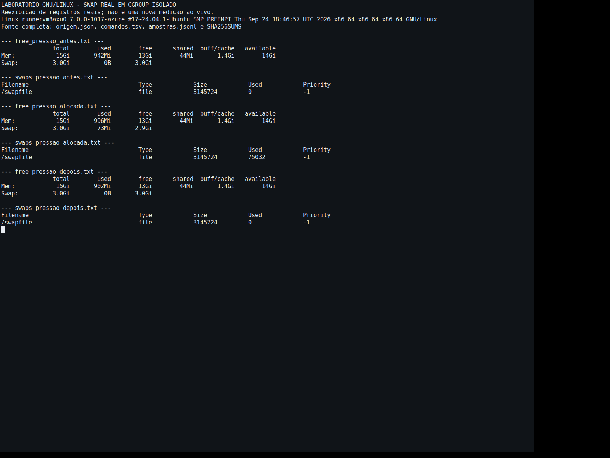
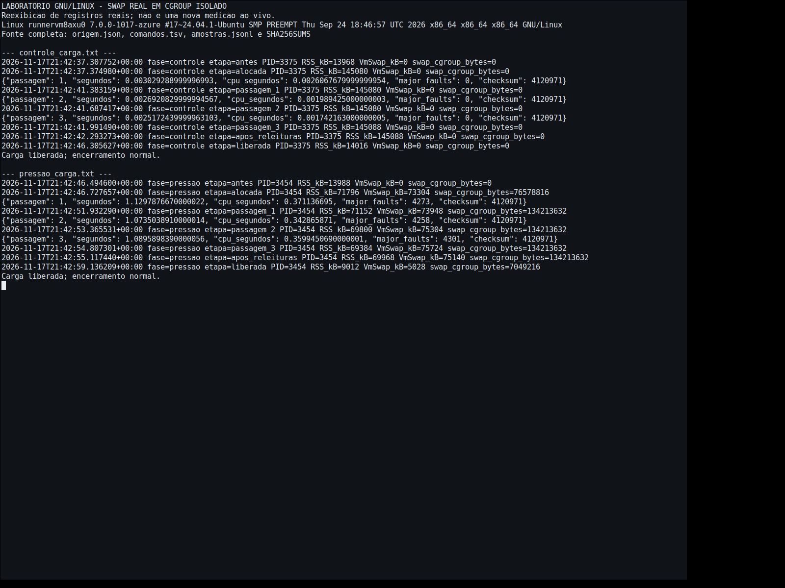

# Complemento real — swap sob pressão isolada

**Uso de swap, movimentação de páginas e impacto de E/S foram observados em 17/11/2026.** Esta coleta complementa o laboratório de 13/11, cuja carga de 32 MiB não utilizou swap. Os registros anteriores continuam preservados com seus resultados originais.

## Origem e método

- [Execução 44182556307](https://github.com/henri16bit/trabalho-walter/actions/runs/44182556307), commit `1a422ec27a0240af708da2ce7be04ace581b725a`.
- [Pasta da coleta](swap_linux_20261117T214237Z_3360/), iniciada às **21:42:37 UTC / 18:42:37 em São Paulo**, Ubuntu 24.04.5 LTS, kernel `7.0.0-1017-azure`.
- [60 comandos registrados](swap_linux_20261117T214237Z_3360/comandos.tsv), todos com código 0; as duas cargas terminaram normalmente, com `ExecMainStatus=0` e `Result=success`.
- [SHA256SUMS](swap_linux_20261117T214237Z_3360/SHA256SUMS): 75 arquivos conferidos. A [proveniência](swap_linux_20261117T214237Z_3360/proveniencia.json) identifica o artefato original e seu hash.
- As três capturas são de um xterm real em Xvfb reexibindo os registros, obtidas por `scrot`. Não são novas medições no instante da captura nem imagens de IA.

O [script](../scripts/laboratorio_swap.py) criou dois serviços transitórios sequenciais, cada um com um processo Python do usuário `runner`. Ambos alocaram **128 MiB de memória anônima privada**, escreveram um byte não nulo em cada página de 4096 bytes e realizaram três passagens de leitura e reescrita de um byte por página. Os checksums foram iguais a 4.120.971 nas seis passagens. Páginas enormes foram desabilitadas apenas nesse mapeamento.

O controle teve `memory.max=256 MiB`; a fase de pressão, **64 MiB**. Isso tornou a carga elevada em relação à RAM permitida ao cgroup, sem esgotar a RAM global do servidor. O kernel reclamou memória do grupo e utilizou o swap já existente. Os limites estão nas configurações reais de [controle](swap_linux_20261117T214237Z_3360/controle_configuracao.txt) e [pressão](swap_linux_20261117T214237Z_3360/pressao_configuracao.txt). Referências: [cgroup v2](https://docs.kernel.org/admin-guide/cgroup-v2.html) e [controles de recursos do systemd](https://www.freedesktop.org/software/systemd/man/latest/systemd.resource-control.html).

Cada serviço teve limites de **256 MiB de swap, 512 MiB de espaço virtual, 20 s de CPU, 60 s de duração e oito tarefas**. O script exigiu ao menos 1 GiB de RAM disponível e 512 MiB de swap livre e verificou os limites dos ancestrais. `OOMPolicy=kill` permitiria encerrar somente o grupo em caso de OOM; **nenhum evento OOM ocorreu**. O monitor encerra suas próprias unidades, inclusive se houver erro. Não houve `swapoff`, criação de swap, alteração de `swappiness` ou instalação de recursos Linux no Windows.

O sistema informou `swappiness=60` e zswap desabilitado (`N`); `MemoryZSwapMax=0` foi aplicado somente aos dois grupos. Assim, a evidência de E/S não corresponde a uma demonstração exclusivamente de compressão em RAM.

## Resultados medidos

Fonte: [resumo JSON](swap_linux_20261117T214237Z_3360/resumo.json), [CSV](swap_linux_20261117T214237Z_3360/comparacao.csv) e amostras completas de [controle](swap_linux_20261117T214237Z_3360/controle_amostras.jsonl) / [pressão](swap_linux_20261117T214237Z_3360/pressao_amostras.jsonl).

| Medida | Controle — PID 3375 | Pressão — PID 3454 |
|---|---:|---:|
| Alocação em cada processo | 128 MiB | 128 MiB |
| Limite de RAM do cgroup | 256 MiB | 64 MiB |
| Maior `memory.swap.current` amostrado | 0 B | 134.213.632 B ≈ 127,996 MiB |
| Maior `VmSwap` amostrado | 0 KiB | 75.724 KiB ≈ 73,949 MiB |
| Soma do tempo das três passagens | 0,008239 s | 3,292881 s |
| CPU nas três passagens | 0,006338 s | 1,073948 s |
| Major faults durante as três passagens | 0 | 12.832 |
| Δ `pswpin` global | 0 páginas | 101.052 páginas |
| Δ `pswpout` global | 0 páginas | 118.184 páginas |
| Δ `io.stat` — leituras do cgroup | 0 B | 413.949.952 B ≈ 394,773 MiB |
| Δ `io.stat` — escritas do cgroup | 16.384 B | 484.184.064 B ≈ 461,754 MiB |
| `oom` / `oom_kill` | 0 / 0 | 0 / 0 |

Os deltas de `pswpin/out` e `io.stat` abrangem de `antes` até `apos_releituras`, incluindo a alocação e a instrumentação. Tempos e major faults da tabela somam apenas os três laços medidos. As pausas usadas para coletar `free` e `memstat` não entram nesses tempos.

### Entrada, uso e liberação do swap

O arquivo `/swapfile` já existia, com aproximadamente 3 GiB. `/proc/swaps` registrou:

| Momento | Swap usado (KiB) | Saída original |
|---|---:|---|
| Antes da pressão | 0 | [swaps_pressao_antes.txt](swap_linux_20261117T214237Z_3360/swaps_pressao_antes.txt) |
| Após alocar e tocar as páginas | 75.032 | [swaps_pressao_alocada.txt](swap_linux_20261117T214237Z_3360/swaps_pressao_alocada.txt) |
| Após as três passagens | 131.068 | [swaps_pressao_apos_releituras.txt](swap_linux_20261117T214237Z_3360/swaps_pressao_apos_releituras.txt) |
| Depois do encerramento da unidade | 0 | [swaps_pressao_depois.txt](swap_linux_20261117T214237Z_3360/swaps_pressao_depois.txt) |

`free -h` mostrou, respectivamente, **0 B → 73 MiB → 127 MiB → 0 B**. A RAM global disponível continuou em aproximadamente **14 GiB**. As medições são consecutivas, não simultâneas. O maior valor do cgroup não é igual ao maior `VmSwap`: há diferenças de abrangência e contabilização, e páginas residentes podem manter espaço no arquivo de swap. A coleta registra `SwapCached` e `swapcached` nos dados brutos. Referências: [proc_pid_status(5)](https://man7.org/linux/man-pages/man5/proc_pid_status.5.html) e [proc_meminfo(5)](https://man7.org/linux/man-pages/man5/proc_meminfo.5.html).

### Impacto de E/S e limites da comparação

Houve movimentação real de páginas: os deltas globais equivalem a **394,734 MiB entrando** e **461,656 MiB saindo**, usando páginas de 4096 bytes. Como esses contadores são globais, o vínculo com a carga é sustentado também pelo swap do cgroup, `VmSwap`, major faults e E/S do próprio grupo. `io.stat` inclui também logs e metadados, portanto não se atribui cada byte registrado exclusivamente ao swap.

Na amostra `apos_releituras`, o PSI `io.pressure` do grupo de pressão apresentou `full total=1074919`, em microssegundos, e `memory.pressure` apresentou `full total=293515`. Esses tempos de espera acumulados reforçam a observação de contenção; não devem ser somados entre si nem subtraídos diretamente do tempo dos laços, pois os intervalos e eventos diferem. Referência: [documentação de PSI](https://docs.kernel.org/accounting/psi.html).

As três passagens foram aproximadamente **399,7 vezes mais lentas nesta execução**. Trata-se de uma comparação demonstrativa entre dois processos executados em sequência, com recuperação de memória, faltas, E/S, execução Python e escalonamento. Não é uma estimativa universal do custo de swap nem uma medição isolada da velocidade do disco. O controle durou poucos milissegundos, o que torna a razão sensível a pequenas variações. Não foram calculados intervalos de confiança.

**Resultado para o enunciado:** o início de uso de swap, sua movimentação e o impacto observado sobre tempo e E/S foram demonstrados sob **pressão de memória limitada ao cgroup**. Essa condição deve constar na apresentação: não houve esgotamento da RAM de todo o servidor. A coleta atende à observação técnica que faltava à atividade 3; a revisão acadêmica e a entrega da dupla continuam necessárias.
