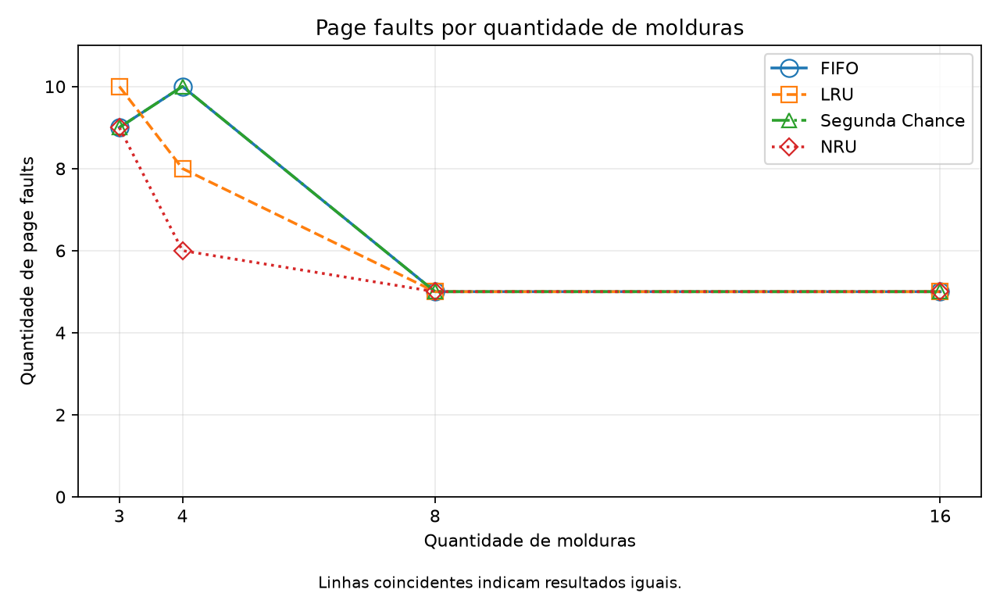
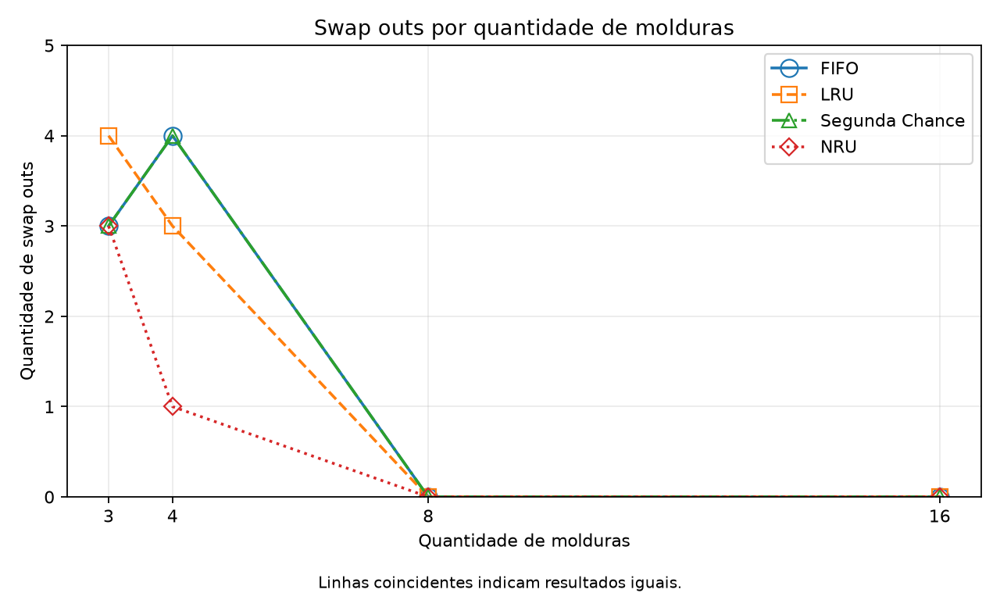

# Gerência de Memória Virtual, Paginação e Monitoramento no GNU/Linux

## 1. Capa e identificação

**Instituição:** UNIRP  
**Curso:** Análise e Desenvolvimento de Sistemas  
**Disciplina:** Sistemas Operacionais  
**Professor:** Walter Gomes Pedroso Junior  
**Trabalho:** Projeto semestral — gerência de memória virtual  
**Integrante 1:** [preencher nome e RA]  
**Integrante 2:** [preencher nome e RA]  
**Data de preparação:** 07/11/2026  
**Data de entrega:** [preencher]

**Situação do trabalho:** simulador implementado e testado no Windows, com CSV e gráficos reais. Laboratório GNU/Linux preparado, mas ainda não executado. As evidências e interpretações dessa etapa devem ser acrescentadas antes da entrega final.

## 2. Fundamentação teórica

### 2.1. Memória virtual, MMU e paginação

A memória virtual oferece a cada processo um espaço de endereços próprio. Os endereços usados pelo programa não precisam corresponder diretamente às posições da RAM. Essa organização permite isolamento entre processos e o gerenciamento de regiões como código, dados, heap e pilha. Memória virtual não é sinônimo de swap: a tradução e a proteção dos endereços continuam existindo mesmo sem uma área de swap configurada. A organização do espaço de endereços é apresentada por Arpaci-Dusseau e Arpaci-Dusseau em [OSTEP, capítulo 13](https://pages.cs.wisc.edu/~remzi/OSTEP/vm-intro.pdf).

Na paginação, o espaço virtual é dividido em páginas e a memória física em molduras. A **MMU** (Memory Management Unit) participa da tradução do endereço virtual para o físico. A **tabela de páginas**, mantida pelo sistema operacional, associa páginas a molduras e armazena informações de presença, permissões e uso. O deslocamento dentro da página é preservado na tradução. A TLB pode guardar traduções recentes para acelerar esse processo. Esses conceitos são descritos em [OSTEP, capítulo 18](https://pages.cs.wisc.edu/~remzi/OSTEP/vm-paging.pdf).

### 2.2. Page faults e páginas modificadas

No modelo deste trabalho, um **page fault** ocorre quando a página referenciada não está na memória simulada. Se há moldura livre, ela é utilizada. Se todas estão ocupadas, o algoritmo escolhe uma vítima. Uma página modificada precisa ter seu conteúdo preservado antes de sair, e essa retirada é contabilizada como **swap out**.

No sistema real, uma falta de página pode ser resolvida sem leitura de disco, por exemplo na criação de uma página zerada ou em determinadas situações de cópia na escrita. Portanto, o número de faltas não corresponde automaticamente ao número de operações de disco. O simulador simplifica esse funcionamento: não modela tempos, arquivos, TLB nem a política atual do kernel Linux. Os mecanismos de paginação sob demanda são discutidos em [OSTEP, capítulo 21](https://pages.cs.wisc.edu/~remzi/OSTEP/vm-beyondphys.pdf).

O bit **R** indica que a página foi referenciada no período considerado. O bit **M**, também chamado Dirty, indica modificação. Neste programa, escrever define M como 1; uma leitura posterior não o apaga. Somente a substituição de uma página com M=1 incrementa o contador de gravações. Carregar uma página pela primeira vez não é swap out, e as páginas que permanecem na memória ao terminar a sequência não são descarregadas artificialmente.

### 2.3. Estados dos processos

Um processo em **Running** está executando na CPU. Em **Ready**, está apto a executar, aguardando sua vez. Em **Blocked**, espera um evento, como a conclusão de uma operação de entrada/saída. O escalonador realiza transições entre esses estados; após o evento esperado, um processo bloqueado pode voltar à condição de pronto. Essa divisão conceitual é apresentada em [OSTEP, capítulo 4](https://pages.cs.wisc.edu/~remzi/OSTEP/cpu-intro.pdf).

No Linux, o código `R` engloba execução e prontidão; uma captura do `ps` não separa essas duas situações. `S` representa espera interrompível e `D`, espera não interrompível, frequentemente relacionada a E/S. Ambos podem corresponder à espera do modelo Blocked. `T` indica processo parado e `Z`, processo terminado cujo estado ainda não foi recolhido pelo pai. Consulte o [manual de ps](https://man7.org/linux/man-pages/man1/ps.1.html).

## 3. Metodologia e modelagem do simulador

### 3.1. Organização

O programa foi desenvolvido em Python 3, com execução pelo terminal. Foram utilizadas funções, listas, dicionários e laços. A biblioteca padrão cuida da entrada, dos arquivos e do CSV; matplotlib é a única dependência direta externa e gera imagens PNG sem abrir janelas.

`main.py` recebe a configuração, executa os algoritmos e apresenta a tabela. `algoritmos.py` contém as políticas de substituição. `graficos.py` exporta os resultados. `testes.py` verifica o funcionamento. O programa aceita a sequência pronta ou páginas e operações digitadas pelo usuário, além de uma ou mais quantidades de molduras.

Cada moldura ocupada é representada por um dicionário. Todos os algoritmos guardam o número da página e M; LRU também guarda o índice do último acesso, enquanto Clock e NRU utilizam R. A memória é uma lista limitada pela quantidade de molduras. Os contadores e a memória são criados novamente em cada chamada, sem compartilhar estado entre algoritmos.

### 3.2. Políticas implementadas

| Algoritmo | Critério e implementação |
|---|---|
| FIFO | A lista representa a ordem de chegada. A vítima é o primeiro elemento. Acertos preservam a posição da página na fila. |
| LRU | Cada acesso atualiza um índice de tempo lógico. A vítima é a página com o menor índice de último acesso. |
| Segunda Chance (Clock) | Um ponteiro percorre a lista circularmente. R=1 concede uma segunda chance e é zerado; R=0 permite a substituição. O ponteiro avança após a inserção. |
| NRU | A vítima pertence à menor classe disponível, calculada por `2*R + M`. O desempate usa o menor índice de moldura. |

O NRU utiliza as seguintes classes:

| Classe | R | M | Interpretação |
|---|---|---|---|
| 0 | 0 | 0 | Não referenciada no período e não modificada |
| 1 | 0 | 1 | Não referenciada no período e modificada |
| 2 | 1 | 0 | Referenciada no período e não modificada |
| 3 | 1 | 1 | Referenciada no período e modificada |

Foi fixado o intervalo de **quatro acessos** para a limpeza de R no NRU. A limpeza acontece antes dos acessos **5, 9, 13 e assim por diante**, contando acertos e faltas. Depois da limpeza, o acesso atual marca R=1 para a página acessada. M é preservado. Essa regra e o desempate por índice tornam os resultados reproduzíveis. Uma página substituta ocupa o índice da vítima.

No Clock, R é zerado durante o percurso do ponteiro; não se aplica a limpeza periódica do NRU. LRU foi escolhido como a alternativa solicitada no enunciado; Aging não foi acrescentado.

### 3.3. Condições e validação

A memória começa vazia. Os quatro algoritmos recebem as mesmas páginas e operações. O programa rejeita molduras menores que 1, páginas negativas ou não inteiras, sequência vazia, operações desconhecidas e quantidades diferentes de páginas e operações.

A validação foi executada em **Windows 10, Python 3.12.14, matplotlib 3.11.2**. Foram aprovados **25/25 testes**, incluindo:

- Contadores conferidos por acesso e sequência conhecida somente de leitura.
- Ordem do FIFO, atualização do LRU, ponteiro e referência do Clock e quatro classes do NRU.
- Escrita em página residente, preservação de Dirty em leituras e retirada de páginas limpas ou modificadas.
- Independência de estado, uma moldura e comparações com 3, 4, 8 e 16 molduras.
- Rejeição de entradas inválidas, entrada manual, pasta com espaços, conteúdo do CSV e decodificação dos dois PNG.
- Análise de sintaxe do Python embutido no roteiro Linux, sem executar a carga.

As imagens foram inspecionadas visualmente. O comando `bash -n laboratorio_linux.sh` passou no Git Bash do Windows, e a tentativa de executar o script nesse sistema foi recusada pela verificação de plataforma. O registro real está em [resultados/validacao_windows.txt](resultados/validacao_windows.txt). **A execução dos comandos Linux e a execução do simulador no Linux não foram validadas nesta sessão.**

## 4. Resultados da simulação

### 4.1. Entrada e resultados obtidos

Os resultados abaixo foram efetivamente gerados pelo programa. São **12 acessos** e cinco páginas distintas:

```text
Páginas:   1 2 3 4 1 2 5 1 2 3 4 5
Operações: E L E L L E E L L E L L
```

L representa leitura; E representa escrita. O CSV completo está em [resultados/comparacao.csv](resultados/comparacao.csv).

**Tabela 1 — Quantidade de page faults.**

| Algoritmo | 3 molduras | 4 molduras | 8 molduras | 16 molduras |
|---|---:|---:|---:|---:|
| FIFO | 9 | 10 | 5 | 5 |
| LRU | 10 | 8 | 5 | 5 |
| Segunda Chance | 9 | 10 | 5 | 5 |
| NRU | 9 | 6 | 5 | 5 |

**Tabela 2 — Quantidade de swap outs.**

| Algoritmo | 3 molduras | 4 molduras | 8 molduras | 16 molduras |
|---|---:|---:|---:|---:|
| FIFO | 3 | 4 | 0 | 0 |
| LRU | 4 | 3 | 0 | 0 |
| Segunda Chance | 3 | 4 | 0 | 0 |
| NRU | 3 | 1 | 0 | 0 |



*Figura 1 — Page faults. Fonte: execução do simulador desenvolvido neste trabalho.*



*Figura 2 — Swap outs. Fonte: execução do simulador desenvolvido neste trabalho. Linhas coincidentes representam resultados iguais.*

### 4.2. Conferência manual

Foi acompanhada a sequência com **três molduras**, partindo da memória vazia. A tabela apresenta **F/S**, isto é, faltas e gravações acumuladas depois de cada acesso. Os testes comparam esses valores calculados passo a passo com a execução de cada prefixo da sequência.

| Acesso | Página | Operação | FIFO F/S | LRU F/S | Clock F/S | NRU F/S |
|---|---:|:---:|---:|---:|---:|---:|
| 1 | 1 | E | 1/0 | 1/0 | 1/0 | 1/0 |
| 2 | 2 | L | 2/0 | 2/0 | 2/0 | 2/0 |
| 3 | 3 | E | 3/0 | 3/0 | 3/0 | 3/0 |
| 4 | 4 | L | 4/1 | 4/1 | 4/1 | 4/0 |
| 5 | 1 | L | 5/1 | 5/1 | 5/1 | 4/0 |
| 6 | 2 | E | 6/2 | 6/2 | 6/2 | 5/0 |
| 7 | 5 | E | 7/2 | 7/2 | 7/2 | 6/1 |
| 8 | 1 | L | 7/2 | 7/2 | 7/2 | 6/1 |
| 9 | 2 | L | 7/2 | 7/2 | 7/2 | 6/1 |
| 10 | 3 | E | 8/2 | 8/3 | 8/2 | 7/2 |
| 11 | 4 | L | 9/3 | 9/3 | 9/3 | 8/3 |
| 12 | 5 | L | 9/3 | 10/4 | 9/3 | 9/3 |

Por exemplo, no FIFO as primeiras três páginas ocupam molduras livres e não geram gravações. No quarto acesso, sai a página 1, que estava modificada. Nos acessos 6 e 11, saem as páginas modificadas 3 e 2. Isso explica os três swap outs. Os acessos 8, 9 e 12 são acertos, totalizando nove faltas.

No NRU, no quarto acesso a página 2 pertence à classe 2, enquanto 1 e 3 pertencem à classe 3. A vítima é, portanto, a página 2 limpa; não há gravação nesse acesso. A limpeza antes do quinto acesso altera as classes futuras, sem apagar M.

Também foi conferido um caso mínimo com uma moldura: páginas `1, 1, 1, 2` e operações `E, E, L, L`. Todos os algoritmos produziram **duas faltas e um swap out**. A leitura da página 1 não apaga sua modificação, e escrever duas vezes não transforma sua retirada em duas gravações.

### 4.3. Comparação

Com três molduras, FIFO, Clock e NRU obtiveram nove faltas e três gravações, enquanto LRU obteve dez faltas e quatro gravações. Com quatro molduras, o NRU apresentou seis faltas e uma gravação; para essa sequência e essas regras de limpeza, foram os menores valores entre os algoritmos comparados.

O FIFO passou de nove para dez faltas quando a capacidade aumentou de três para quatro molduras. Esse comportamento exemplifica a **anomalia de Belady**. O Clock implementado apresentou o mesmo aumento nessa entrada. Já o LRU passou de dez para oito faltas. A discussão de políticas e da anomalia está em [OSTEP, capítulo 22](https://pages.cs.wisc.edu/~remzi/OSTEP/vm-beyondphys-policy.pdf).

Com oito ou dezesseis molduras, as cinco páginas distintas cabem simultaneamente na memória. Assim, todos os algoritmos apresentam somente as cinco faltas de primeira referência e nenhum swap out. Nesse caso, aumentar de oito para dezesseis molduras não muda os contadores.

Os resultados dependem da sequência, das operações e da configuração. O bom resultado do NRU neste exemplo não demonstra superioridade geral; outra sequência ou outro intervalo de limpeza pode alterar a comparação. Os números medem o simulador, não o desempenho ou o swap real do computador.

## 5. Laboratório GNU/Linux

**Etapa pendente de execução.** Não há capturas ou saídas Linux anexadas. Os campos abaixo deverão ser preenchidos com evidências reais. O [README](README.md) contém o procedimento para usar um Linux remoto, os pacotes necessários e os comandos completos. O script `laboratorio_linux.sh` reúne as três atividades e salva as saídas em uma subpasta datada de `evidencias/`.

**Ambiente remoto/distribuição:** [preencher]  
**Kernel e data da coleta:** [preencher]  
**Responsáveis:** [preencher]  
**Pasta das saídas reais:** [preencher]

### 5.1. Atividade 1 — mapa de memória

Será iniciado um processo Python no Linux, seu PID será registrado e serão executados `pmap -x <PID>` e `cat /proc/<PID>/maps`. `pmap` apresenta os mapeamentos do processo; a opção `-x` solicita a saída estendida. Deve-se diferenciar tamanho virtual e páginas residentes ao interpretar as colunas. Referência: [manual de pmap](https://man7.org/linux/man-pages/man1/pmap.1.html).

Para identificar as regiões, serão usadas as seguintes orientações:

| Região | Indício a procurar nos mapeamentos reais |
|---|---|
| Text/Código | Mapeamento executável, normalmente `r-xp`, associado ao executável Python ou a uma biblioteca. O código de máquina observado é o do interpretador. |
| Data/BSS | Regiões graváveis ligadas ao executável e regiões anônimas relacionadas; a identificação é aproximada sem examinar as seções ELF. |
| Heap | Região identificada como `[heap]`. Alocações dinâmicas também podem usar outros mapeamentos anônimos. |
| Stack | Região identificada como `[stack]`, associada à pilha principal. |
| Bibliotecas | Caminhos de arquivos compartilhados, como arquivos `.so`, possivelmente com vários mapeamentos e permissões. |

Em `/proc/<PID>/maps`, `r` significa leitura, `w` escrita e `x` execução; `p` indica mapeamento privado e `s`, compartilhado. Um traço indica ausência da permissão naquela posição. Se a saída de `pmap -x` não mostrar permissões, elas serão consultadas em `maps`. Nem toda região anônima é o heap. Referência: [manual de proc_pid_maps](https://man7.org/linux/man-pages/man5/proc_pid_maps.5.html).

**Capturas reais:** [inserir pmap e maps, com PID legível]  
**Interpretação dos endereços e permissões observados:** [preencher]  
**Limitações encontradas:** [preencher, se houver]

### 5.2. Atividade 2 — processos e chamadas de sistema

Serão utilizados `ps aux`, `top` e `strace -c <comando>`. No `ps`, serão anotados PID, `STAT`, `%CPU`, `%MEM`, RSS e VSZ. RSS representa memória residente; VSZ, tamanho virtual, ambos normalmente expressos em KiB nessa ferramenta. `%CPU` no `ps` corresponde à utilização média durante a vida do processo. O estado será interpretado conforme a seção 2.3. Referência: [manual de ps](https://man7.org/linux/man-pages/man1/ps.1.html).

O `top` permite acompanhar atualizações sucessivas. Serão comparados CPU e memória do processo observado, anotando o intervalo e as unidades exibidas. O script usa `top -b -n 2 -d 1` para salvar duas amostras em texto; a versão interativa permite uma captura de tela e é encerrada com `q`. Referência: [manual de top](https://man7.org/linux/man-pages/man1/top.1.html).

O `strace -c` resume as chamadas ao kernel, suas contagens, erros e tempos. Serão explicadas as chamadas que efetivamente aparecerem; `read`, `openat` e `mmap` são exemplos possíveis, não resultados já observados. O resumo não conta todas as funções Python. Se o ambiente impedir rastreamento por `ptrace`, a mensagem real será preservada. Referência: [manual de strace](https://man7.org/linux/man-pages/man1/strace.1.html).

**Capturas reais:** [inserir ps/top e strace]  
**PID, estado, CPU e memória observados:** [preencher com unidades]  
**Chamadas de sistema e interpretação:** [preencher]  
**Limitações encontradas:** [preencher, se houver]

### 5.3. Atividade 3 — memória RAM e swap

Serão executados `free -h`, `memstat` e `cat /proc/swaps`. No `free`, **total** é a memória utilizável informada pelo sistema; **free** é a parcela livre; **available** estima quanto pode ser usado por novas aplicações sem recorrer a swap. A memória usada deve ser interpretada conforme a versão da ferramenta; no manual consultado, é calculada como total menos disponível. Buffers e caches ajudam a explicar por que memória livre e disponível diferem. A linha Swap informa capacidade, uso e espaço livre. Referência: [manual de free](https://man7.org/linux/man-pages/man1/free.1.html).

O `memstat` apresenta uso de memória virtual por processos e objetos compartilhados, e não um total equivalente à RAM residente. A visibilidade dos processos pode ser limitada por permissões. Ausência do comando ou acesso incompleto deve ser registrado. Referência: [manual de memstat](https://manpages.debian.org/trixie/memstat/memstat.1.en.html).

O arquivo `/proc/swaps` lista as áreas de swap. Se houver somente cabeçalho, será registrada a ausência de uma área disponível no ambiente, impedindo observar seu uso. Não será criado swap apenas para produzir uma evidência. Referência: [manual de proc_swaps](https://man7.org/linux/man-pages/man5/proc_swaps.5.html).

O script propõe uma carga de **até 32 MiB por 20 segundos**, tocando as páginas alocadas. A quantidade fica também limitada a 10% da margem verificada. Antes de alocar, exige pelo menos 256 MiB disponíveis, considera `MemAvailable` e os limites visíveis de cgroup v2, e aplica um limite de espaço virtual ao próprio processo. Se a verificação não for possível ou a margem for insuficiente, a carga é dispensada com uma mensagem. O script não altera limites de cgroup ou configurações de swap. Os arquivos do controlador são descritos na [documentação do kernel sobre cgroup v2](https://docs.kernel.org/admin-guide/cgroup-v2.html).

Serão comparadas as medições antes, durante e depois. Uma carga pequena pode não causar movimentação de swap mesmo quando ele existe. Os contadores `pswpin` e `pswpout` de `/proc/vmstat`, também registrados, ajudam a observar movimentação de páginas, mas incluem atividade de outros processos. Portanto, mudanças globais não serão atribuídas exclusivamente ao teste. Referência: [manual de proc_vmstat](https://man7.org/linux/man-pages/man5/proc_vmstat.5.html).

**Capturas reais:** [inserir free, memstat e /proc/swaps]  
**Carga executada ou dispensada, com motivo:** [preencher]  
**Comparação de RAM antes/durante/depois:** [preencher]  
**Swap configurado e movimentação observada:** [preencher]  
**Limitações de ferramentas, permissões ou contêiner:** [preencher]

## 6. Conclusão

O desenvolvimento do simulador permitiu representar decisões de substituição de páginas com estruturas simples e verificar seus efeitos sobre faltas e gravações. Os testes confirmaram o funcionamento de FIFO, LRU, Segunda Chance e NRU nas entradas analisadas, incluindo a preservação do bit Dirty e a independência entre as execuções.

A comparação mostrou que a quantidade de molduras e o padrão de acessos influenciam os resultados. O caso do FIFO evidenciou que aumentar a capacidade nem sempre reduz faltas nessa política. Quando todas as páginas distintas couberam na memória, as diferenças entre algoritmos desapareceram para a sequência utilizada.

O roteiro GNU/Linux foi preparado para relacionar esses conceitos aos mapeamentos e às ferramentas de monitoramento. **Essa etapa permanece pendente**, e ainda não é possível concluir algo sobre a RAM, o swap ou as chamadas de sistema de um ambiente Linux observado. Após a execução remota, a dupla deverá acrescentar as evidências, interpretações e limitações à seção 5 e atualizar esta conclusão.

## 7. Referências bibliográficas

Fontes técnicas consultadas em 07/11/2026:

1. ARPACI-DUSSEAU, Remzi H.; ARPACI-DUSSEAU, Andrea C. **Operating Systems: Three Easy Pieces**. Versão 1.10. Arpaci-Dusseau Books, novembro de 2023. [Página oficial do livro](https://pages.cs.wisc.edu/~remzi/OSTEP/). Capítulos utilizados: [4 — The Process](https://pages.cs.wisc.edu/~remzi/OSTEP/cpu-intro.pdf), [13 — Address Spaces](https://pages.cs.wisc.edu/~remzi/OSTEP/vm-intro.pdf), [18 — Paging](https://pages.cs.wisc.edu/~remzi/OSTEP/vm-paging.pdf), [21 — Beyond Physical Memory: Mechanisms](https://pages.cs.wisc.edu/~remzi/OSTEP/vm-beyondphys.pdf) e [22 — Beyond Physical Memory: Policies](https://pages.cs.wisc.edu/~remzi/OSTEP/vm-beyondphys-policy.pdf).
2. PROCPS-NG. Manuais [pmap(1)](https://man7.org/linux/man-pages/man1/pmap.1.html), [ps(1)](https://man7.org/linux/man-pages/man1/ps.1.html), [top(1)](https://man7.org/linux/man-pages/man1/top.1.html) e [free(1)](https://man7.org/linux/man-pages/man1/free.1.html).
3. LINUX MAN-PAGES PROJECT. Manuais [proc_pid_maps(5)](https://man7.org/linux/man-pages/man5/proc_pid_maps.5.html), [proc_swaps(5)](https://man7.org/linux/man-pages/man5/proc_swaps.5.html) e [proc_vmstat(5)](https://man7.org/linux/man-pages/man5/proc_vmstat.5.html).
4. STRACE PROJECT. [strace(1) — Linux manual page](https://man7.org/linux/man-pages/man1/strace.1.html).
5. DEBIAN. [memstat(1) — manual do pacote memstat](https://manpages.debian.org/trixie/memstat/memstat.1.en.html).
6. LINUX KERNEL DOCUMENTATION. [Control Group v2](https://docs.kernel.org/admin-guide/cgroup-v2.html).
7. GITHUB DOCS. [Creating a codespace for a repository](https://docs.github.com/en/codespaces/developing-in-a-codespace/creating-a-codespace-for-a-repository). Referência para o procedimento de execução remota descrito no README.
