# Gerência de Memória Virtual, Paginação e Monitoramento no GNU/Linux

## 1. Capa e identificação

**Instituição:** UNIRP  
**Curso:** Análise e Desenvolvimento de Sistemas  
**Disciplina:** Sistemas Operacionais  
**Professor:** Walter Gomes Pedroso Junior  
**Trabalho:** Projeto semestral — gerência de memória virtual  
**Integrante 1:** [preencher nome e RA]  
**Integrante 2:** [preencher nome e RA]  
**Data de revisão:** 17/11/2026  
**Data de entrega:** [preencher]

**Ambiente de referência:** GNU/Linux, distribuição Ubuntu 24.04.5 LTS. O simulador com interface gráfica e terminal foi executado no Ubuntu remoto, assim como os comandos do laboratório. A compatibilidade adicional com Windows não altera o ambiente utilizado para as evidências deste relatório.

**Situação do trabalho:** 33 testes sem janela e 9 testes gráficos aprovados no Ubuntu em 17/11/2026. As três atividades do laboratório foram executadas em 13/11/2026, com capturas e saídas reais. A carga controlada consumiu RAM, mas **não provocou uso de swap**; o impacto de E/S sob pressão permanece não demonstrado. Faltam a identificação da dupla, sua revisão final e a exportação para PDF ou Google Docs.

## 2. Fundamentação teórica

### 2.1. Memória virtual, MMU e paginação

A memória virtual oferece a cada processo um espaço de endereços próprio. Os endereços usados pelo programa não precisam corresponder diretamente às posições da RAM. Essa organização permite isolamento entre processos e o gerenciamento de regiões como código, dados, heap e pilha. Memória virtual não é sinônimo de swap: a tradução e a proteção dos endereços continuam existindo mesmo sem uma área de swap configurada. A organização do espaço de endereços é apresentada por Arpaci-Dusseau e Arpaci-Dusseau em [OSTEP, capítulo 13](https://pages.cs.wisc.edu/~remzi/OSTEP/vm-intro.pdf).

Na paginação, o espaço virtual é dividido em páginas e a memória física em molduras. A **MMU** (Memory Management Unit) participa da tradução do endereço virtual para o físico. A **tabela de páginas**, mantida pelo sistema operacional, associa páginas a molduras e armazena informações de presença, permissões e uso. O deslocamento dentro da página é preservado na tradução. A TLB pode guardar traduções recentes para acelerar esse processo. Esses conceitos são descritos em [OSTEP, capítulo 18](https://pages.cs.wisc.edu/~remzi/OSTEP/vm-paging.pdf).

### 2.2. Page faults e páginas modificadas

No modelo deste trabalho, um **page fault** ocorre quando a página referenciada não está na memória simulada. Se há moldura livre, ela é utilizada. Se todas estão ocupadas, o algoritmo escolhe uma vítima. Uma página modificada precisa ter seu conteúdo preservado antes de sair, e essa retirada é contabilizada como **swap out**.

No sistema real, uma falta de página pode ser resolvida sem leitura de disco, por exemplo na criação de uma página zerada ou em determinadas situações de cópia na escrita. Portanto, o número de faltas não corresponde automaticamente ao número de operações de disco. O simulador simplifica esse funcionamento: não modela tempos, arquivos, TLB nem a política atual do kernel Linux. Os mecanismos de paginação sob demanda são discutidos em [OSTEP, capítulo 21](https://pages.cs.wisc.edu/~remzi/OSTEP/vm-beyondphys.pdf).

O bit **R** indica que a página foi referenciada no período considerado. O bit **M**, também chamado Dirty, indica modificação. Neste programa, escrever define M como 1; uma leitura posterior não o apaga. Somente a substituição de uma página com M=1 incrementa o contador de gravações. Carregar uma página pela primeira vez não é swap out, e as páginas que permanecem na memória ao terminar a sequência não são descarregadas artificialmente.

### 2.3. Estados dos processos

Um processo em **Running** está executando na CPU. Em **Ready**, está apto a executar, aguardando sua vez. Em **Blocked**, espera um evento, como a conclusão de uma operação de entrada/saída. O escalonador realiza transições entre esses estados; após o evento esperado, um processo bloqueado pode voltar à condição de pronto. Essa divisão conceitual é apresentada em [OSTEP, capítulo 4](https://pages.cs.wisc.edu/~remzi/OSTEP/cpu-intro.pdf).

No Linux, o código `R` engloba execução e prontidão; uma captura do `ps` não separa essas duas situações. `S` representa espera interrompível e `D`, espera não interrompível, frequentemente relacionada a E/S. Ambos podem corresponder à espera do modelo Blocked. `T` indica processo parado e `Z`, processo terminado cujo estado ainda não foi recolhido pelo pai. Consulte o [manual de ps](https://man7.org/linux/man-pages/man1/ps.1.html).

## 3. Metodologia e modelagem do simulador

### 3.1. Organização

O programa foi desenvolvido em Python 3, com **interface gráfica Tkinter/ttk e execução pelo terminal**. As duas formas de uso compartilham as mesmas funções de simulação. A biblioteca padrão cuida das entradas, arquivos, CSV e widgets; matplotlib é a única dependência direta externa e produz os gráficos PNG. O pacote `python3-tk` fornece o Tkinter no Ubuntu. Tkinter está disponível também em Windows, conforme a [documentação do Python](https://docs.python.org/3/library/tkinter.html); essa portabilidade não significa exclusividade de plataforma.

| Arquivo | Responsabilidade |
|---|---|
| [interface.py](interface.py) | `main()` abre a janela; `Interface.executar()` calcula a simulação; `selecionar_passo()` atualiza RAM e histórico; `comparar()` gera as 16 combinações; `salvar()` e `visualizar_graficos()` exportam e exibem resultados |
| [main.py](main.py) | `main()` recebe opções do terminal; `executar_simulacoes()` chama os algoritmos; `exibir_tabela()` imprime os resultados |
| [algoritmos.py](algoritmos.py) | `fifo()`, `lru()`, `segunda_chance()` e `nru()` calculam faltas, gravações e histórico opcional; `registrar_etapa()` copia o estado de cada acesso |
| [graficos.py](graficos.py) | `salvar_csv()` e `salvar_graficos()` gravam o CSV e os dois PNG a partir dos resultados calculados |
| [testes.py](testes.py) | Verificações dos algoritmos, entradas, histórico, CLI, exportação e widgets reais |

Os campos permitem escolher páginas, operações L/E, algoritmo e molduras. A aba Simulação mostra os totais, uma tabela de histórico, o estado de cada moldura e os botões de navegação. A aba Comparação usa a mesma sequência para os quatro algoritmos com 3, 4, 8 e 16 molduras, permitindo visualizar gráficos e salvar CSV/PNG.

Cada moldura ocupada é representada por um dicionário. Todos os algoritmos guardam a página e M; LRU também guarda o último acesso, enquanto Clock e NRU utilizam R. FIFO mantém a ordem de chegada separada dos índices de moldura exibidos. O histórico contém cópias independentes dos estados e preserva as posições físicas simuladas. Os contadores e a memória são recriados em cada chamada.

### 3.2. Políticas implementadas

| Algoritmo | Critério e implementação |
|---|---|
| FIFO | A lista representa a ordem de chegada. A vítima é o primeiro elemento. Acertos preservam a posição da página na fila. |
| LRU | Cada acesso atualiza um índice de tempo lógico. A vítima é a página com o menor índice de último acesso. |
| Segunda Chance (Clock) | Um ponteiro percorre a lista circularmente. R=1 concede uma segunda chance e é zerado; R=0 permite a substituição. O ponteiro avança após a inserção. |
| NRU | A vítima pertence à menor classe disponível, calculada por `2*R + M`. O desempate usa o menor índice de moldura. |

O NRU utiliza as seguintes classes:

| Classe | R | M | Interpretação |
|---|---|---|---|
| 0 | 0 | 0 | Não referenciada no período e não modificada |
| 1 | 0 | 1 | Não referenciada no período e modificada |
| 2 | 1 | 0 | Referenciada no período e não modificada |
| 3 | 1 | 1 | Referenciada no período e modificada |

Foi fixado o intervalo de **quatro acessos** para a limpeza de R no NRU. A limpeza acontece antes dos acessos **5, 9, 13 e assim por diante**, contando acertos e faltas. Depois da limpeza, o acesso atual marca R=1 para a página acessada. M é preservado. Essa regra e o desempate por índice tornam os resultados reproduzíveis. Uma página substituta ocupa o índice da vítima.

No Clock, R é zerado durante o percurso do ponteiro; não se aplica a limpeza periódica do NRU. LRU foi escolhido como a alternativa solicitada no enunciado; Aging não foi acrescentado.

### 3.3. Condições e validação

A memória começa vazia. Os quatro algoritmos recebem as mesmas páginas e operações. O programa rejeita molduras menores que 1, páginas negativas ou não inteiras, sequência vazia, operações desconhecidas e quantidades diferentes de páginas e operações.

A validação documentada aqui foi executada em **Ubuntu 24.04.5 LTS, kernel `7.0.0-1014-aws`, Python 3.12.3 e matplotlib 3.11.2**, em 17/11/2026. O [registro do ambiente](evidencias/simulador_linux_20261117_44179462467/ambiente.txt) identifica a distribuição, o kernel, a data e o commit `02190dc5b331d977eb8c3992258e9a9805604e7c`. A [execução 44179462467 no GitHub Actions](https://github.com/henri16bit/trabalho-walter/actions/runs/44179462467) terminou com sucesso.

| Conjunto | Resultado real | Componentes validados |
|---|---|---|
| [Testes sem janela](evidencias/simulador_linux_20261117_44179462467/testes_logica.txt) | **33/33** | Regras dos quatro algoritmos, Dirty, classes/limpeza do NRU, contadores por acesso, entradas inválidas, independência, histórico e molduras fixas, parsing da GUI, CLI manual, CSV e decodificação de PNG |
| [Testes gráficos](evidencias/simulador_linux_20261117_44179462467/testes_interface.txt) | **9/9** | Campos e seleção dos quatro algoritmos, acionamento dos botões, navegação e RAM, histórico, reinício, comparação com 16 linhas, exportação/cancelamento, janela dos gráficos e dimensões de widgets |

Os nove testes gráficos criam **janelas Tk reais em Xvfb**, um display virtual no Ubuntu. Os campos, seleções e callbacks são acionados por código; os diálogos de escolha de pasta e confirmação têm respostas programadas. Isso valida comportamento dos widgets, mas **não equivale a uma sessão humana de cliques e digitação**. O teste de sintaxe do roteiro Linux, incluído no primeiro conjunto, também não executa o laboratório; a execução efetiva está na seção 5.

O [registro antigo do Windows](resultados/validacao_windows.txt), com 25 testes, foi conservado como histórico. Os 25 casos originais integram o conjunto atual de 33; esse arquivo antigo não é utilizado como comprovação de Linux.

### 3.4. Comprovação visual e reprodução no Linux

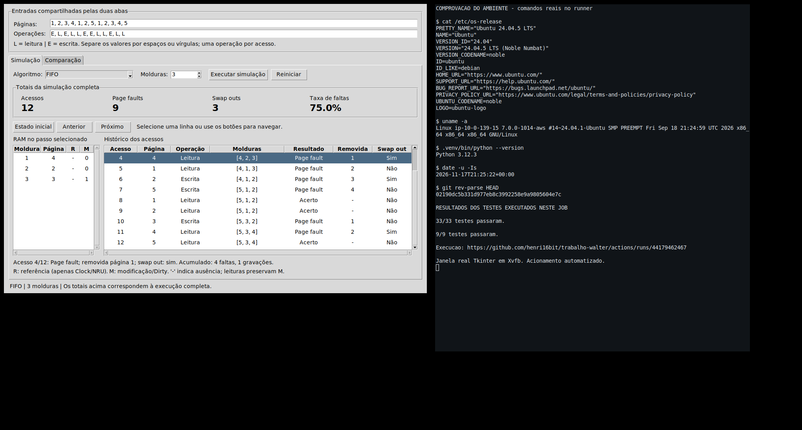

*Figura 1 — Captura real obtida por `scrot` no display Xvfb do Ubuntu remoto, em 17/11/2026 às 21:25 UTC (18:25 em São Paulo). À esquerda, FIFO com três molduras, 12 acessos, nove faltas e três swap outs simulados; o histórico está no quarto acesso. À direita, xterm executando os comandos de identificação do sistema e exibindo os totais lidos dos logs desse mesmo job. Simulação e navegação acionadas por código. Fonte: execução 44179462467.*

Há também capturas da [comparação dos 16 resultados](evidencias/simulador_linux_20261117_44179462467/interface_comparacao.png) e da [simulação com 16 molduras](evidencias/simulador_linux_20261117_44179462467/interface_16_molduras.png). Os PNGs preservam os pixels capturados no runner; não são montagens ou imagens geradas por IA.

Para conferir a origem, o leitor pode cruzar a Figura 1 com `ambiente.txt`, os dois logs de testes, o [workflow de captura](.github/workflows/validar-linux.yml) e o link da execução. O [manifesto SHA256SUMS](evidencias/simulador_linux_20261117_44179462467/SHA256SUMS) cobre 12 arquivos e permite verificar sua integridade. A [proveniência](evidencias/simulador_linux_20261117_44179462467/proveniencia.json) registra o artefato original e seu hash. O hash verifica igualdade dos arquivos; o vínculo com a execução documenta sua origem.

Após a instalação descrita no [README](README.md), o comando para uso normal em uma sessão gráfica Ubuntu é:

```bash
cd ~/Projetos/trabalho-walter
.venv/bin/python interface.py
```

O runner remoto usado para estas evidências não instala WSL, Docker ou máquina virtual no computador Windows da dupla. A janela da Figura 1 está sendo renderizada no Linux remoto.

## 4. Resultados da simulação

### 4.1. Entrada e resultados obtidos

Os resultados abaixo foram efetivamente gerados pelo programa. São **12 acessos** e cinco páginas distintas:

```text
Páginas:   1 2 3 4 1 2 5 1 2 3 4 5
Operações: E L E L L E E L L E L L
```

L representa leitura; E representa escrita. O [CSV desta execução Ubuntu](evidencias/simulador_linux_20261117_44179462467/comparacao.csv) e a [saída do terminal](evidencias/simulador_linux_20261117_44179462467/terminal.txt) contêm os mesmos 16 resultados abaixo. Foram produzidos por `.venv/bin/python main.py --saida resultados/validacao_linux`: `executar_simulacoes()` calcula os valores, `exibir_tabela()` os imprime e as funções de `graficos.py` gravam CSV e PNG. Esses arquivos foram copiados do artefato sem edição dos valores.

**Tabela 1 — Quantidade de page faults.**

| Algoritmo | 3 molduras | 4 molduras | 8 molduras | 16 molduras |
|---|---:|---:|---:|---:|
| FIFO | 9 | 10 | 5 | 5 |
| LRU | 10 | 8 | 5 | 5 |
| Segunda Chance | 9 | 10 | 5 | 5 |
| NRU | 9 | 6 | 5 | 5 |

**Tabela 2 — Quantidade de swap outs.**

| Algoritmo | 3 molduras | 4 molduras | 8 molduras | 16 molduras |
|---|---:|---:|---:|---:|
| FIFO | 3 | 4 | 0 | 0 |
| LRU | 4 | 3 | 0 | 0 |
| Segunda Chance | 3 | 4 | 0 | 0 |
| NRU | 3 | 1 | 0 | 0 |

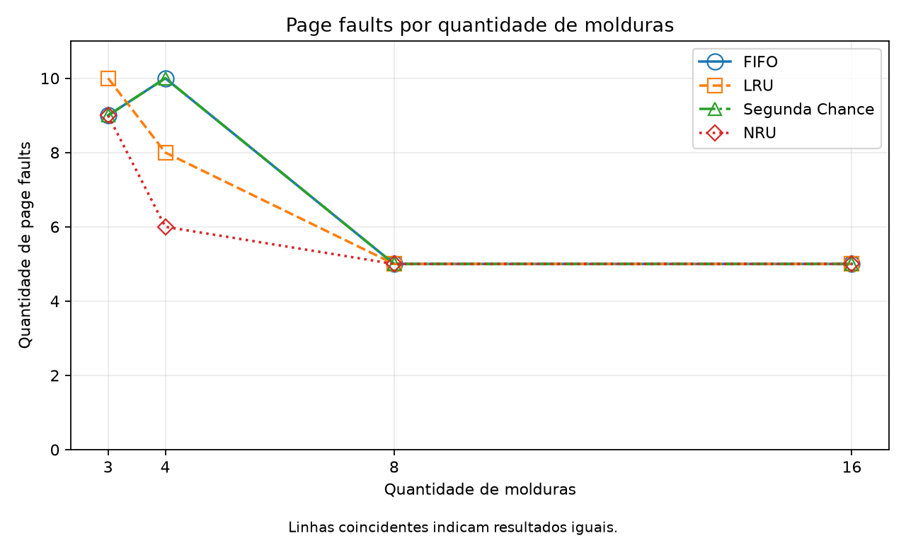

*Figura 2 — Page faults. Fonte: simulador executado no Ubuntu, execução 44179462467 de 17/11/2026.*

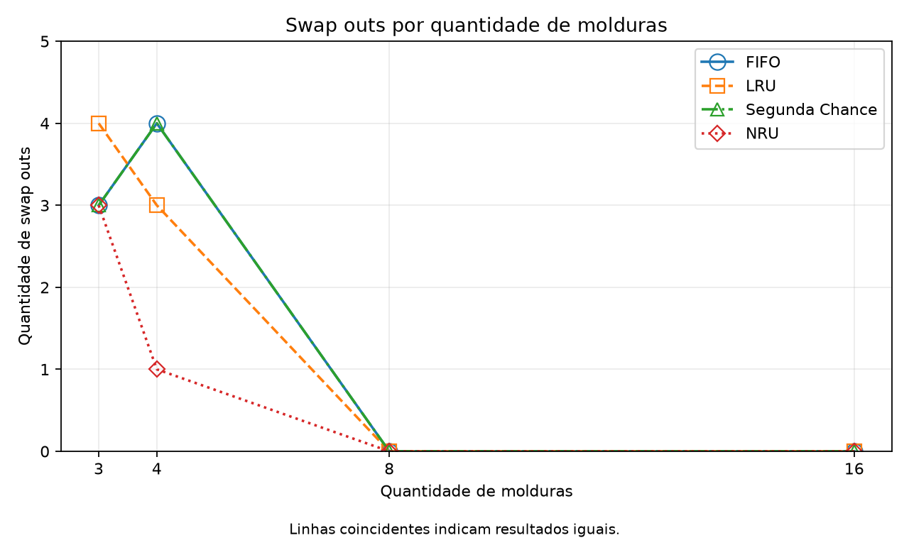

*Figura 3 — Swap outs simulados. Fonte: mesma execução Ubuntu. Linhas coincidentes representam resultados iguais. Esses números não medem o uso de swap do kernel.*

### 4.2. Conferência manual

Foi acompanhada a sequência com **três molduras**, partindo da memória vazia. A tabela apresenta **F/S**, isto é, faltas e gravações acumuladas depois de cada acesso. Os testes comparam esses valores calculados passo a passo com a execução de cada prefixo da sequência.

| Acesso | Página | Operação | FIFO F/S | LRU F/S | Clock F/S | NRU F/S |
|---|---:|:---:|---:|---:|---:|---:|
| 1 | 1 | E | 1/0 | 1/0 | 1/0 | 1/0 |
| 2 | 2 | L | 2/0 | 2/0 | 2/0 | 2/0 |
| 3 | 3 | E | 3/0 | 3/0 | 3/0 | 3/0 |
| 4 | 4 | L | 4/1 | 4/1 | 4/1 | 4/0 |
| 5 | 1 | L | 5/1 | 5/1 | 5/1 | 4/0 |
| 6 | 2 | E | 6/2 | 6/2 | 6/2 | 5/0 |
| 7 | 5 | E | 7/2 | 7/2 | 7/2 | 6/1 |
| 8 | 1 | L | 7/2 | 7/2 | 7/2 | 6/1 |
| 9 | 2 | L | 7/2 | 7/2 | 7/2 | 6/1 |
| 10 | 3 | E | 8/2 | 8/3 | 8/2 | 7/2 |
| 11 | 4 | L | 9/3 | 9/3 | 9/3 | 8/3 |
| 12 | 5 | L | 9/3 | 10/4 | 9/3 | 9/3 |

Por exemplo, no FIFO as primeiras três páginas ocupam molduras livres e não geram gravações. No quarto acesso, sai a página 1, que estava modificada. Nos acessos 6 e 11, saem as páginas modificadas 3 e 2. Isso explica os três swap outs. Os acessos 8, 9 e 12 são acertos, totalizando nove faltas.

No NRU, no quarto acesso a página 2 pertence à classe 2, enquanto 1 e 3 pertencem à classe 3. A vítima é, portanto, a página 2 limpa; não há gravação nesse acesso. A limpeza antes do quinto acesso altera as classes futuras, sem apagar M.

Também foi conferido um caso mínimo com uma moldura: páginas `1, 1, 1, 2` e operações `E, E, L, L`. Todos os algoritmos produziram **duas faltas e um swap out**. A leitura da página 1 não apaga sua modificação, e escrever duas vezes não transforma sua retirada em duas gravações.

### 4.3. Comparação

Com três molduras, FIFO, Clock e NRU obtiveram nove faltas e três gravações, enquanto LRU obteve dez faltas e quatro gravações. Com quatro molduras, o NRU apresentou seis faltas e uma gravação; para essa sequência e essas regras de limpeza, foram os menores valores entre os algoritmos comparados.

O FIFO passou de nove para dez faltas quando a capacidade aumentou de três para quatro molduras. Esse comportamento exemplifica a **anomalia de Belady**. O Clock implementado apresentou o mesmo aumento nessa entrada. Já o LRU passou de dez para oito faltas. A discussão de políticas e da anomalia está em [OSTEP, capítulo 22](https://pages.cs.wisc.edu/~remzi/OSTEP/vm-beyondphys-policy.pdf).

Com oito ou dezesseis molduras, as cinco páginas distintas cabem simultaneamente na memória. Assim, todos os algoritmos apresentam somente as cinco faltas de primeira referência e nenhum swap out. Nesse caso, aumentar de oito para dezesseis molduras não muda os contadores.

Os resultados dependem da sequência, das operações e da configuração. O bom resultado do NRU neste exemplo não demonstra superioridade geral; outra sequência ou outro intervalo de limpeza pode alterar a comparação. Os números medem o simulador, não o desempenho ou o swap real do computador.

## 5. Laboratório GNU/Linux

O [roteiro `laboratorio_linux.sh`](laboratorio_linux.sh) foi executado em **13/11/2026, a partir de 20:50:43 UTC (17:50:43 em São Paulo)**, em um Ubuntu remoto do GitHub Actions. A [execução 43505223640](https://github.com/henri16bit/trabalho-walter/actions/runs/43505223640) usou o commit `0d9b57c6f068a195ba1c7160b805e49a7428b6bd`. Os [35 comandos registrados](evidencias/linux_20261113T205043Z_3277/comandos.tsv) retornaram código 0, assim como o [processo da carga](evidencias/linux_20261113T205043Z_3277/carga_exit_code.txt).

| Informação da coleta | Valor / fonte |
|---|---|
| Distribuição | Ubuntu 24.04.5 LTS — [distribuicao.txt](evidencias/linux_20261113T205043Z_3277/distribuicao.txt) |
| Kernel | `7.0.0-1017-azure`, x86_64 — [sistema.txt](evidencias/linux_20261113T205043Z_3277/sistema.txt) |
| Virtualização remota | `microsoft` — [virtualizacao.txt](evidencias/linux_20261113T205043Z_3277/virtualizacao.txt) |
| Ferramentas | Python 3.12.3, procps 4.0.4, strace 6.8 e memstat 1.1 — [versoes.txt](evidencias/linux_20261113T205043Z_3277/versoes.txt) |
| CPU e páginas | Quatro CPUs lógicas; página de 4096 bytes — [cpu.txt](evidencias/linux_20261113T205043Z_3277/cpu.txt) e [pagina_bytes.txt](evidencias/linux_20261113T205043Z_3277/pagina_bytes.txt) |
| Coleta e integridade | [Transcrição](evidencias/linux_20261113T205043Z_3277/execucao.txt), [proveniência](evidencias/linux_20261113T205043Z_3277/proveniencia.json) e [SHA256SUMS](evidencias/linux_20261113T205043Z_3277/SHA256SUMS), com 49 arquivos conferidos |

Esta coleta do laboratório é distinta da validação do simulador em 17/11/2026. Os runners têm kernels diferentes; os PIDs e valores desta seção pertencem exclusivamente à coleta `linux_20261113T205043Z_3277`. A primeira coleta do laboratório também foi preservada no repositório, mas não foi misturada aos dados abaixo.

As Figuras 4–11 são **capturas reais de xterm por `scrot` em Xvfb**, reexibindo as saídas previamente coletadas nesse Ubuntu. Os cabeçalhos informam esse procedimento. Os recortes de `top` e `memstat` são identificados na tela; os TXT completos continuam disponíveis. São evidências visuais dos registros, não medições novas no instante da captura nem demonstrações de interação humana.

O roteiro teve sua sintaxe Bash e Python verificada antes da execução. O processo de demonstração alternou computação e espera, com limite de CPU, e a carga teve limites de memória e duração. O script encerrou apenas os processos que criou. Nenhuma ferramenta exigida esteve ausente ou foi bloqueada nessa coleta.

### 5.1. Atividade 1 — segmentos e permissões

Foram executados `pmap -x 3311` e `cat /proc/3311/maps`: [pmap.txt](evidencias/linux_20261113T205043Z_3277/pmap.txt) e [maps.txt](evidencias/linux_20261113T205043Z_3277/maps.txt). Capturas: [pmap](evidencias/linux_20261113T205043Z_3277/capturas/atividade1_pmap.png) e [maps](evidencias/linux_20261113T205043Z_3277/capturas/atividade1_maps.png).

| Região | Intervalo virtual observado | Interpretação |
|---|---|---|
| Código | `00420000-00703000` | `r-xp`, código do interpretador `/usr/bin/python3.12` |
| Dados | `00a29000-00ba7000` | `rw-p`, região gravável associada ao executável |
| Heap | `083a4000-084a3000` | `rw-p`, identificado como `[heap]` |
| Stack | `7ffd29a34000-7ffd29a56000` | `rw-p`, pilha principal `[stack]` |
| Biblioteca libc | `7fba7f028000-7fba7f1b1000` | `r-xp`, região executável de `libc.so.6`; o mesmo arquivo tem outras regiões de leitura/dados |

`r`, `w` e `x` indicam leitura, escrita e execução; `p` indica mapeamento privado e `s`, compartilhado. Os endereços são virtuais e podem mudar em outra execução. A identificação de dados baseia-se no mapeamento gravável; não foram examinadas as seções ELF para separar `.data` e `.bss`. Regiões anônimas fora de `[heap]` também podem conter alocações dinâmicas. Referência: [proc_pid_maps(5)](https://man7.org/linux/man-pages/man5/proc_pid_maps.5.html).

O `pmap -x` totalizou **19.524 KiB virtuais, 11.444 KiB residentes e 4.888 KiB Dirty**. Nem todo espaço virtual estava residente. Dirty descreve páginas modificadas; não é contador de swap out e não comprova gravação em disco. Referência: [pmap(1)](https://man7.org/linux/man-pages/man1/pmap.1.html).

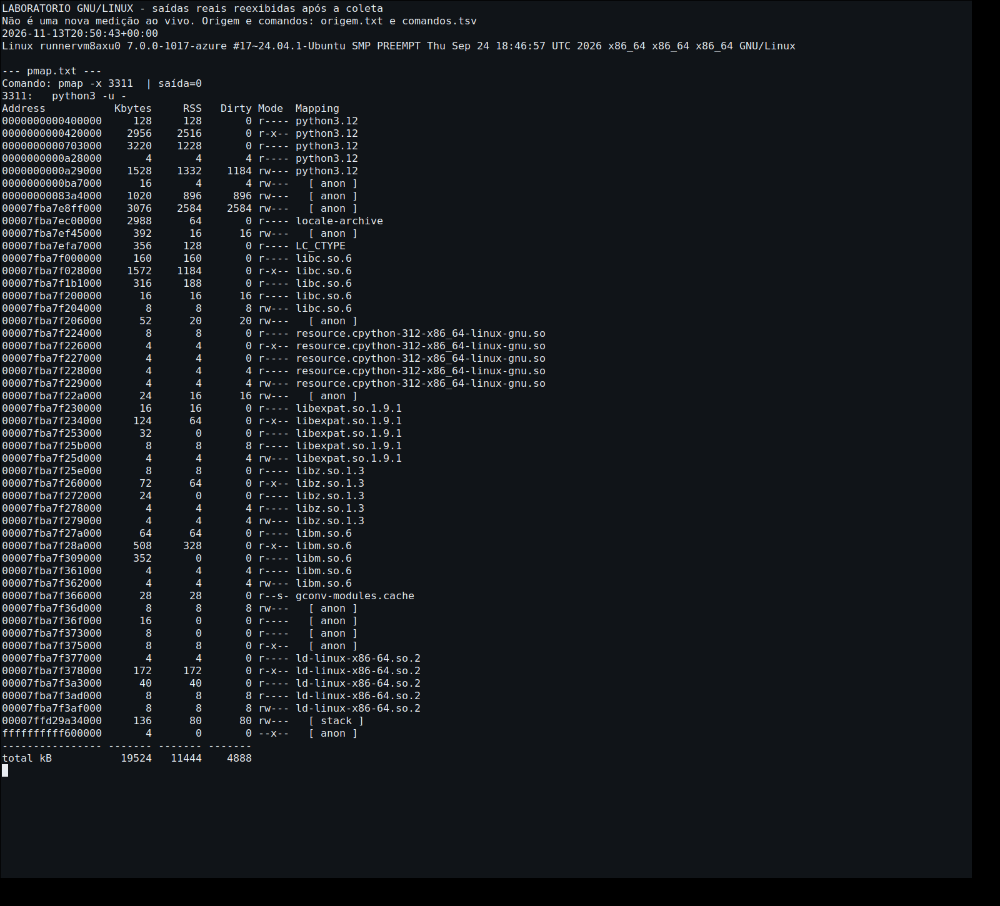

*Figura 4 — Mapa estendido do processo 3311, obtido com pmap -x. Captura de reexibição das saídas reais, coleta Ubuntu de 13/11/2026, execução 43505223640.*

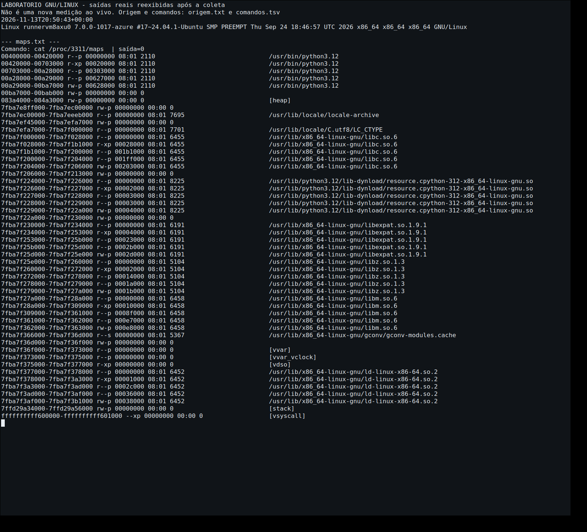

*Figura 5 — Regiões e permissões em /proc/3311/maps. Captura de reexibição das saídas reais, coleta Ubuntu de 13/11/2026, execução 43505223640.*

### 5.2. Atividade 2 — processos e chamadas de sistema

Saídas completas: [ps aux](evidencias/linux_20261113T205043Z_3277/ps_aux.txt), [ps do processo](evidencias/linux_20261113T205043Z_3277/ps_processo.txt), [12 amostras de estados](evidencias/linux_20261113T205043Z_3277/estados.txt), [5 amostras de top](evidencias/linux_20261113T205043Z_3277/top.txt), [strace](evidencias/linux_20261113T205043Z_3277/strace.txt). Capturas: [estados](evidencias/linux_20261113T205043Z_3277/capturas/atividade2_estados.png), [top](evidencias/linux_20261113T205043Z_3277/capturas/atividade2_top.png) e [strace](evidencias/linux_20261113T205043Z_3277/capturas/atividade2_strace.png).

O PID **3311** passou de `S` às 20:50:44.426 UTC para `R` às 20:50:46.459 e voltou a `S` às 20:50:47.476. Em espera, `WCHAN=hrtimer_nanosleep`, compatível com o temporizador do programa. `S` é espera interrompível; `R` abrange execução e prontidão. **Não foi possível separar Running de Ready por essas amostras, nem foi demonstrado estado `D` de espera não interrompível.** Referência: [ps(1)](https://man7.org/linux/man-pages/man1/ps.1.html).

A primeira amostra de `ps` apresentou RSS **11.444 KiB**, VSZ **19.520 KiB** e `%CPU=93,5`, mesmo estando em `S`: o percentual considera a vida do processo. No `top`, houve `R` com 64,0% no intervalo, depois `S` com 35,6% e 0,0%. Estado instantâneo e utilização no intervalo são medidas diferentes. Foi utilizado `top -b -n 5 -d 1`, não uma sessão humana interativa. Referência: [top(1)](https://man7.org/linux/man-pages/man1/top.1.html).

O `strace -c` iniciou e rastreou um Python que leu `/proc/meminfo`: **1.674 bytes**, **769 chamadas**, **90 retornos de erro de syscalls**, soma de tempos **0,003841 s**, código final do comando **0**. Não houve bloqueio de ptrace.

| Chamada | Quantidade | Função |
|---|---:|---|
| `newfstatat` | 211 | Consultar metadados |
| `read` | 72 | Ler descritores |
| `openat` | 59 | Abrir arquivos |
| `mmap` | 29 | Criar mapeamentos virtuais |
| `brk` | 15 | Ajustar o limite da área de dados |
| `close` | 53 | Fechar descritores |

O resumo inclui inicialização e importações do Python, não apenas a leitura final. Os 90 retornos de erro não significam 90 falhas do laboratório. Sem argumentos e errno de cada chamada, não se atribui causa específica a esses retornos. Os tempos não constituem benchmark. Referência: [strace(1)](https://man7.org/linux/man-pages/man1/strace.1.html).

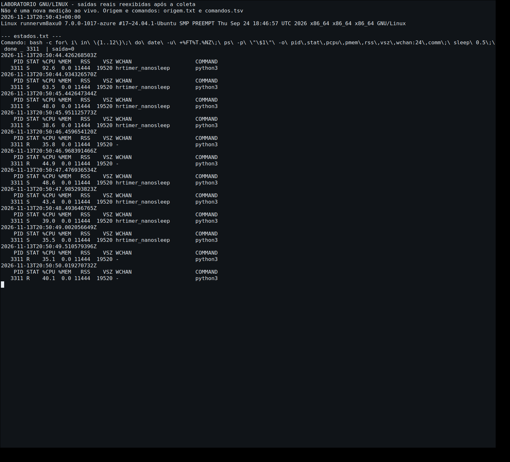

*Figura 6 — Amostras de estados do processo 3311 no ps. Captura de reexibição das saídas reais, coleta Ubuntu de 13/11/2026, execução 43505223640.*

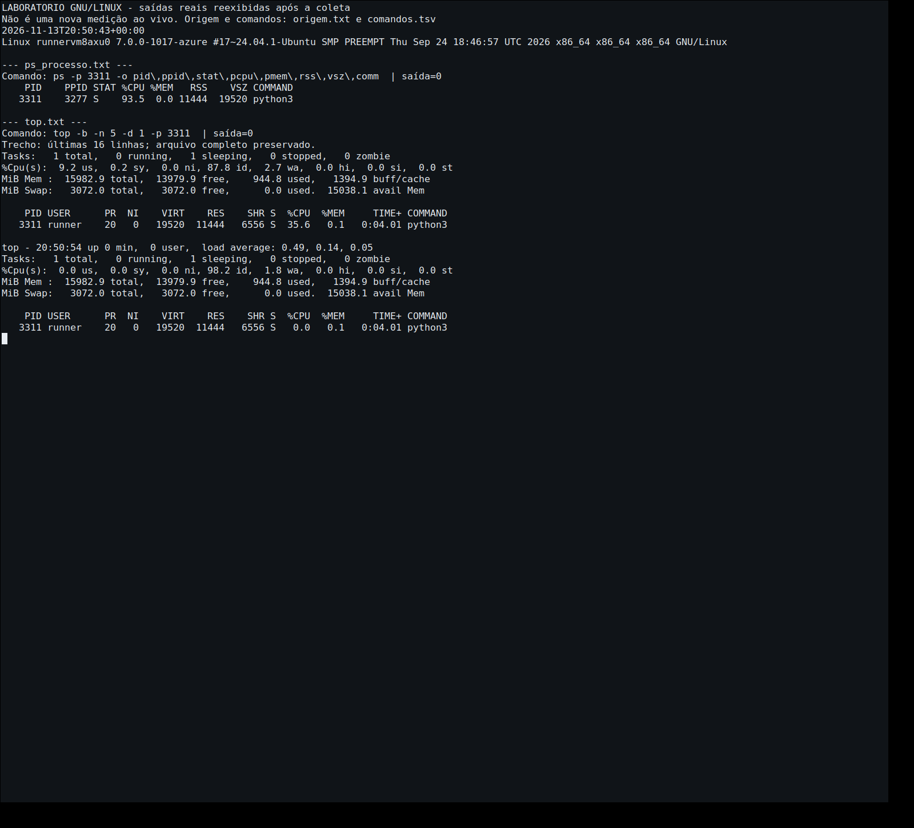

*Figura 7 — Atualizações de CPU, memória e estado no top. Captura de reexibição das saídas reais, coleta Ubuntu de 13/11/2026, execução 43505223640.*

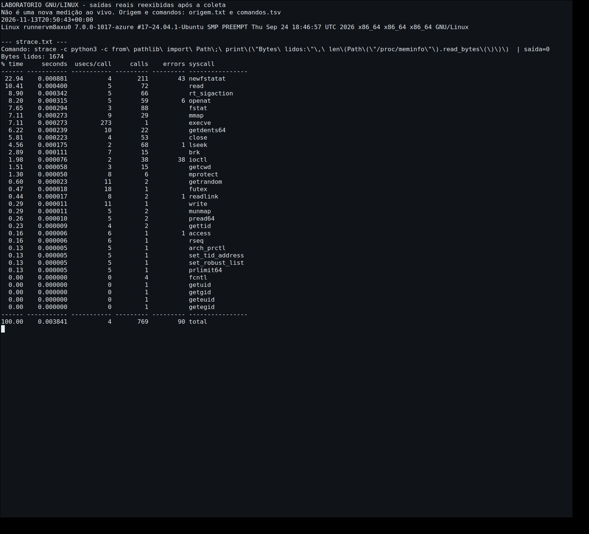

*Figura 8 — Resumo real das chamadas de sistema pelo strace -c. Captura de reexibição das saídas reais, coleta Ubuntu de 13/11/2026, execução 43505223640.*

### 5.3. Atividade 3 — RAM, carga e swap

Saídas: [carga](evidencias/linux_20261113T205043Z_3277/carga.txt), [pmap da carga](evidencias/linux_20261113T205043Z_3277/pmap_carga.txt), [ps da carga](evidencias/linux_20261113T205043Z_3277/ps_carga.txt), [memstat antes](evidencias/linux_20261113T205043Z_3277/memstat.txt), [memstat durante](evidencias/linux_20261113T205043Z_3277/memstat_durante.txt), [memstat depois](evidencias/linux_20261113T205043Z_3277/memstat_depois.txt). Capturas: [RAM/swap](evidencias/linux_20261113T205043Z_3277/capturas/atividade3_ram.png), [carga](evidencias/linux_20261113T205043Z_3277/capturas/atividade3_carga.png), [memstat](evidencias/linux_20261113T205043Z_3277/capturas/atividade3_memstat.png).

A carga foi limitada a 32 MiB por 20 segundos e a 10% da margem disponível, exigindo ao menos 256 MiB de margem. O processo aplicou `RLIMIT_AS=256 MiB` e verificou `MemAvailable` e os níveis visíveis de cgroup v2. Os limites `memory.max` e `memory.high` estavam em `max` nos dois níveis lidos. Se não fosse possível verificar os limites, a alocação seria dispensada. O roteiro não criou swap nem aumentou a carga para forçar paginação. Referência dos controles: [documentação de cgroup v2](https://docs.kernel.org/admin-guide/cgroup-v2.html).

A margem inicial considerada foi **15.045 MiB**. O PID **3398** alocou e tocou **32 MiB**, esperou **20,002 s** e liberou a alocação. Seu RSS foi **12.004 → 44.780 → 12.008 KiB**. O aumento de 32.776 KiB é compatível com 32.768 KiB alocados mais pequenas diferenças do próprio processo. Isso comprova a carga independentemente da oscilação global do sistema.

Valores abaixo convertidos de `free -b` por divisão por 1.048.576 e arredondados para três casas. Os arquivos `free_antes.txt`, `free_durante.txt` e `free_depois.txt` preservam também `free -h`; são chamadas consecutivas, não amostras simultâneas.

| Momento / fonte | RAM total (MiB) | Usada (MiB) | Disponível (MiB) | Swap usado | pswpin / pswpout |
|---|---:|---:|---:|---:|---|
| [Antes](evidencias/linux_20261113T205043Z_3277/free_bytes_antes.txt) | 15.982,910 | 932,090 | 15.050,820 | 0 B | 0 / 0 |
| [Durante](evidencias/linux_20261113T205043Z_3277/free_bytes_durante.txt) | 15.982,910 | 973,629 | 15.009,281 | 0 B | 0 / 0 |
| [Depois](evidencias/linux_20261113T205043Z_3277/free_bytes_depois.txt) | 15.982,910 | 945,250 | 15.037,660 | 0 B | 0 / 0 |

O aumento global de aproximadamente **41,539 MiB** supera a carga de 32 MiB: outros processos e caches também variaram. Não atribuir toda a diferença à carga. `available` estima memória disponível para novas aplicações, enquanto `free` conta memória livre. Referência: [free(1)](https://man7.org/linux/man-pages/man1/free.1.html).

O `memstat` retornou 0, mas sua visão é limitada aos processos acessíveis ao usuário `runner`, pois não foi usado como root. O total antes da carga, **550.118.920k**, é memória **virtual**, não RAM ocupada. Durante a carga, indicou **37.988k** privados no PID 3398, separadamente dos objetos compartilhados; esse número não é diretamente equivalente ao RSS de 44.780 KiB. A ferramenta abrevia caminhos longos na saída padrão. Referência: [memstat(1)](https://manpages.debian.org/trixie/memstat/memstat.1.en.html).

[swaps_depois.txt](evidencias/linux_20261113T205043Z_3277/swaps_depois.txt) lista `/swapfile`, tipo `file`, **3.145.724 KiB**, uso 0 e prioridade -1. `free -b` informa **3.221.221.376 bytes**, aproximadamente 3 GiB. A área já existia no runner. Os contadores [antes](evidencias/linux_20261113T205043Z_3277/contadores_swap_antes.txt), [durante](evidencias/linux_20261113T205043Z_3277/contadores_swap_durante.txt) e [depois](evidencias/linux_20261113T205043Z_3277/contadores_swap_depois.txt) ficaram em zero.

**Limitação:** não houve início de uso de swap nem medição de impacto de E/S por paginação. A memória disponível permaneceu ampla. Transferências ao armazenamento podem acrescentar latência e disputar E/S, mas isso é discussão conceitual, não medição desta coleta. Os contadores são globais do kernel. Referências: [proc_swaps(5)](https://man7.org/linux/man-pages/man5/proc_swaps.5.html) e [proc_vmstat(5)](https://man7.org/linux/man-pages/man5/proc_vmstat.5.html).

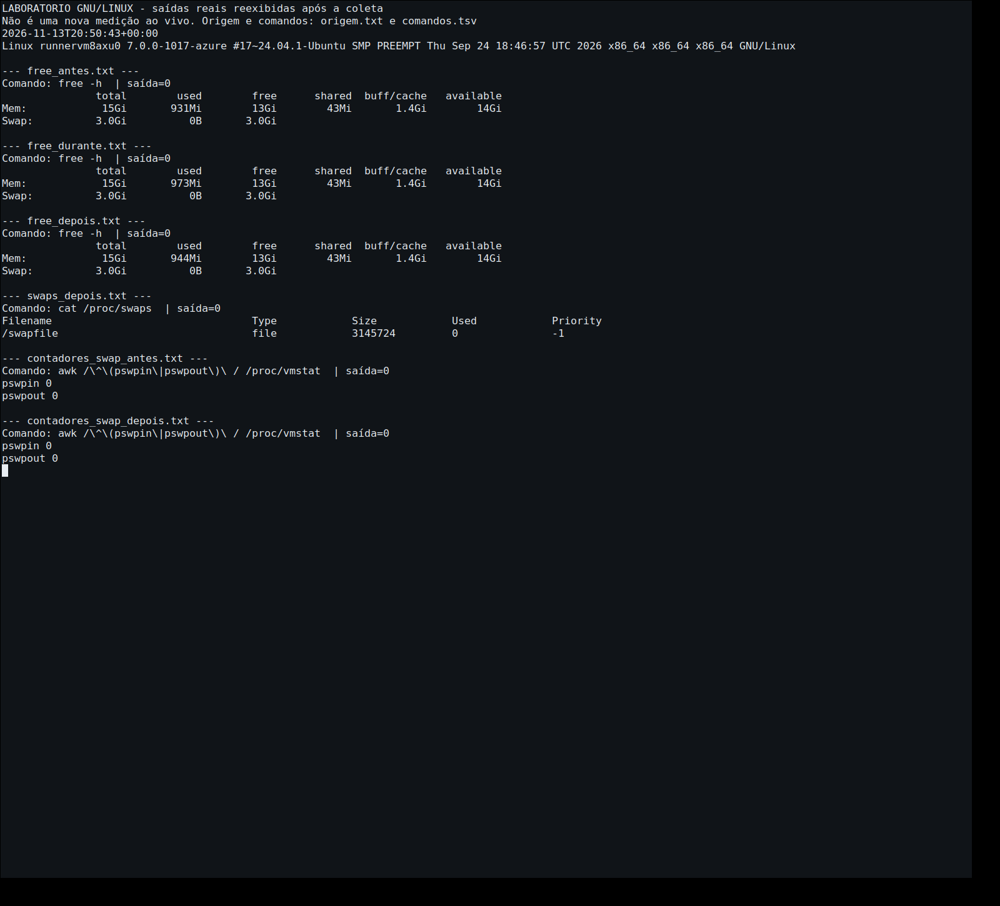

*Figura 9 — RAM, swap e contadores antes, durante e depois da carga. Captura de reexibição das saídas reais, coleta Ubuntu de 13/11/2026, execução 43505223640.*

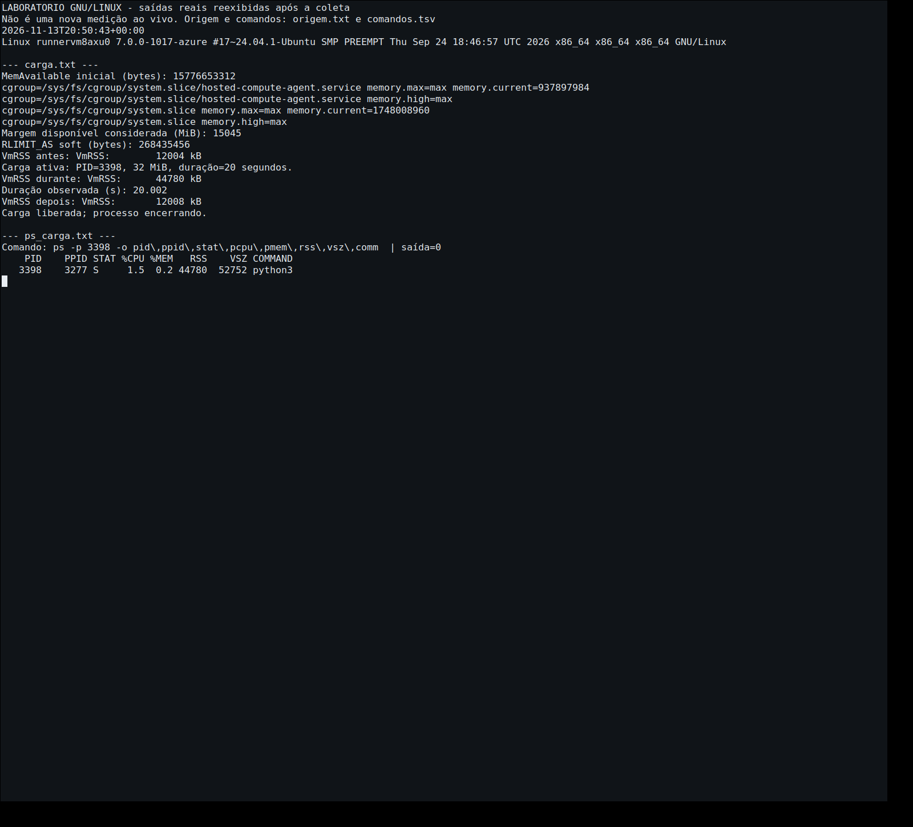

*Figura 10 — Alocação de 32 MiB e RSS do processo 3398. Captura de reexibição das saídas reais, coleta Ubuntu de 13/11/2026, execução 43505223640.*

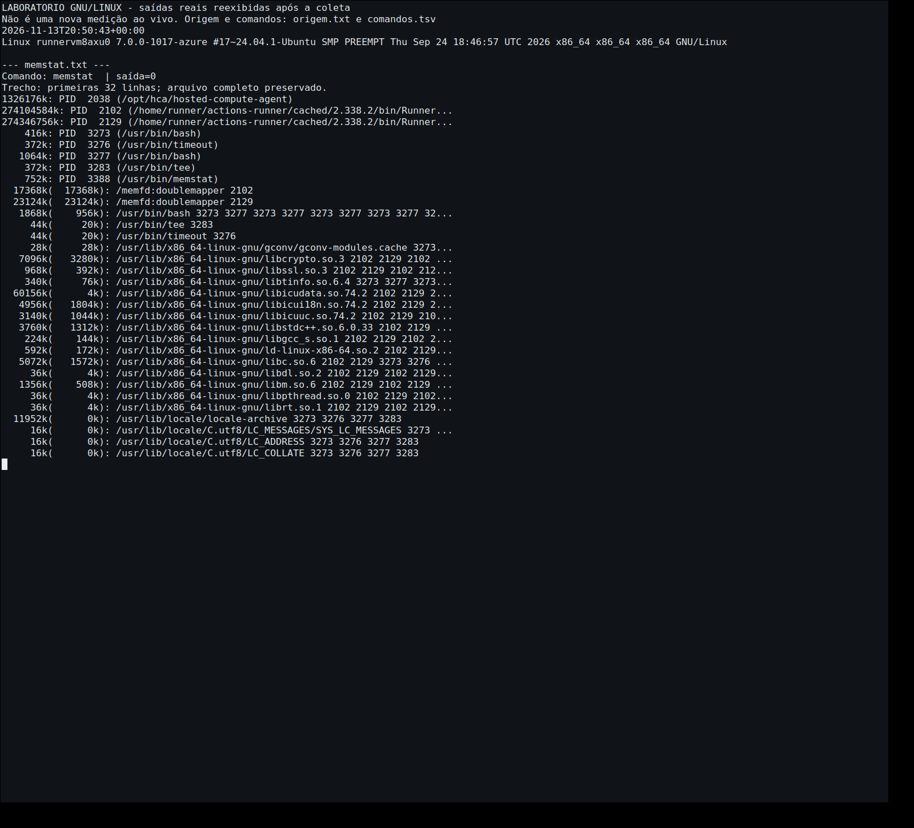

*Figura 11 — Memória virtual dos processos acessíveis no memstat. Captura de reexibição das saídas reais, coleta Ubuntu de 13/11/2026, execução 43505223640.*

### 5.4. Limites do atendimento ao enunciado

Os comandos das três atividades e a carga controlada foram executados. A exigência de observar **início de uso de swap e impacto de E/S sob carga elevada permanece não demonstrada**: a memória disponível continuou ampla e os contadores ficaram em zero. Não é possível declarar atendimento integral dessa parte apenas com um workflow bem-sucedido.

Os demais limites são a visibilidade de `memstat` como usuário `runner`, a identificação aproximada de Data/BSS sem análise de ELF e a ausência de distinção individual de Running/Ready nas amostras `R`. A [matriz de requisitos](evidencias/REQUISITOS.md) relaciona cada exigência às evidências e pendências.

## 6. Conclusão

O desenvolvimento do simulador permitiu representar decisões de substituição de páginas com estruturas simples e verificar seus efeitos sobre faltas e gravações. Os testes confirmaram o funcionamento de FIFO, LRU, Segunda Chance e NRU nas entradas analisadas, incluindo a preservação do bit Dirty e a independência entre as execuções.

A comparação mostrou que a quantidade de molduras e o padrão de acessos influenciam os resultados. O caso do FIFO evidenciou que aumentar a capacidade nem sempre reduz faltas nessa política. Quando todas as páginas distintas couberam na memória, as diferenças entre algoritmos desapareceram para a sequência utilizada.

O laboratório GNU/Linux permitiu observar permissões e regiões do espaço virtual, transições reais R/S e chamadas ao kernel. A carga de 32 MiB elevou o RSS do processo e sua liberação o aproximou do valor inicial. As diferenças entre espaço virtual, memória residente e memória global disponível ficaram visíveis nas ferramentas utilizadas.

Havia swap configurado, mas o uso e os contadores de movimentação permaneceram zerados. Portanto, esta coleta não demonstra paginação para swap sob pressão nem seu impacto de E/S. A validação do simulador e seus swap outs didáticos não preenchem essa lacuna do experimento real.

As evidências apresentam a interface e o laboratório executados no Ubuntu, com saídas, imagens, commits e registros reproduzíveis. A compatibilidade com Windows é adicional. **A dupla ainda deve revisar as interpretações, preencher nomes/RAs e data de entrega, acrescentar suas próprias lições e divisão de responsabilidades e preparar a versão PDF ou Google Docs exigida.** Não foram atribuídas experiências pessoais ou atividades individuais sem confirmação.

## 7. Referências bibliográficas

Referências técnicas da preparação inicial em 07/11/2026 e da análise do laboratório de 13/11/2026. As referências de Python e GitHub e os manuais de `ps`, `free` e `memstat` foram consultados na revisão de 17/11/2026.

1. ARPACI-DUSSEAU, Remzi H.; ARPACI-DUSSEAU, Andrea C. **Operating Systems: Three Easy Pieces**. Versão 1.10. Arpaci-Dusseau Books, novembro de 2023. [Página oficial do livro](https://pages.cs.wisc.edu/~remzi/OSTEP/). Capítulos utilizados: [4 — The Process](https://pages.cs.wisc.edu/~remzi/OSTEP/cpu-intro.pdf), [13 — Address Spaces](https://pages.cs.wisc.edu/~remzi/OSTEP/vm-intro.pdf), [18 — Paging](https://pages.cs.wisc.edu/~remzi/OSTEP/vm-paging.pdf), [21 — Beyond Physical Memory: Mechanisms](https://pages.cs.wisc.edu/~remzi/OSTEP/vm-beyondphys.pdf) e [22 — Beyond Physical Memory: Policies](https://pages.cs.wisc.edu/~remzi/OSTEP/vm-beyondphys-policy.pdf).
2. PROCPS-NG. Manuais [pmap(1)](https://man7.org/linux/man-pages/man1/pmap.1.html), [ps(1)](https://man7.org/linux/man-pages/man1/ps.1.html), [top(1)](https://man7.org/linux/man-pages/man1/top.1.html) e [free(1)](https://man7.org/linux/man-pages/man1/free.1.html).
3. LINUX MAN-PAGES PROJECT. Manuais [proc_pid_maps(5)](https://man7.org/linux/man-pages/man5/proc_pid_maps.5.html), [proc_swaps(5)](https://man7.org/linux/man-pages/man5/proc_swaps.5.html) e [proc_vmstat(5)](https://man7.org/linux/man-pages/man5/proc_vmstat.5.html).
4. STRACE PROJECT. [strace(1) — Linux manual page](https://man7.org/linux/man-pages/man1/strace.1.html).
5. DEBIAN. [memstat(1) — manual do pacote memstat](https://manpages.debian.org/trixie/memstat/memstat.1.en.html).
6. LINUX KERNEL DOCUMENTATION. [Control Group v2](https://docs.kernel.org/admin-guide/cgroup-v2.html).
7. PYTHON SOFTWARE FOUNDATION. [tkinter — Python interface to Tcl/Tk](https://docs.python.org/3/library/tkinter.html). Referência da interface gráfica e de sua disponibilidade em diferentes sistemas.
8. GITHUB DOCS. [Manually running a workflow](https://docs.github.com/en/actions/how-tos/manage-workflow-runs/manually-run-a-workflow) e [Using workflow run logs](https://docs.github.com/en/actions/how-tos/monitor-workflows/use-workflow-run-logs). Referências para iniciar e consultar as execuções remotas.
9. REPOSITÓRIO DO PROJETO. [Validação do simulador em Ubuntu, 17/11/2026](https://github.com/henri16bit/trabalho-walter/actions/runs/44179462467) e [laboratório GNU/Linux, 13/11/2026](https://github.com/henri16bit/trabalho-walter/actions/runs/43505223640). Dados primários preservados em [evidencias/](evidencias/), com [matriz de requisitos](evidencias/REQUISITOS.md).
